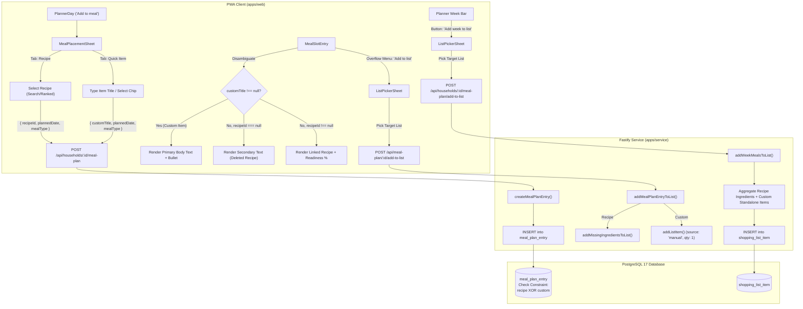

# Phase 15: Flexible Meal Planning (Custom Items & Recipes) - Research

**Researched:** 2026-11-10
**Domain:** Database schema migration, Fastify API routes, React 19 PWA UI, Shopping List integration
**Confidence:** HIGH

<user_constraints>
## User Constraints (from CONTEXT.md)

### Locked Decisions

#### Data Model & Schema Migration (MEAL-01)
- **D-01 (Table columns)**: Add nullable `custom_title text` to `meal_plan_entry` table, make `recipe_title text` nullable, and add a check constraint: `check ((recipe_id is not null and recipe_title is not null) or (recipe_id is null and custom_title is not null) or (recipe_id is null and recipe_title is not null))`. This preserves existing deleted-recipe snapshot behavior (`recipe_id` null, `recipe_title` set) while supporting custom items (`recipe_id` null, `custom_title` set).
- **D-02 (Shared schemas)**: In `@hestia/shared/src/api/meal-plan.ts`, update `mealPlanEntrySchema` to include `customTitle: z.string().nullable()`, update `recipeTitle: z.string().nullable()`, and maintain `readinessPercent: z.int().min(0).max(100).nullable()`. Custom items have `recipeId: null`, `recipeTitle: null`, `customTitle: string`, and `readinessPercent: null`.
- **D-03 (Creation contract)**: Update `createMealPlanEntryRequestSchema` in `@hestia/shared` to accept either `{ recipeId: string, plannedDate, mealType }` OR `{ customTitle: string, plannedDate, mealType }`.
- **D-04 (Deleted recipe disambiguation)**: Explicitly distinguish deleted recipes (`recipeId === null && recipeTitle !== null && customTitle === null`) from custom items (`customTitle !== null`). Custom items never show the deleted recipe notice or styling.

#### Planner UI & Quick-Entry Interaction (MEAL-02)
- **D-05 (Unified placement sheet)**: Enhance the placement dialog/sheet from `PlannerDay` "Add to [meal]" into a unified sheet with tabs: "Recipe" (existing recipe search and deal-matched suggestion ranking) and "Quick Item" (a clean input field with instant submit button and quick food suggestions).
- **D-06 (Ergonomics)**: Submitting a custom item creates the entry and immediately closes the sheet with a success toast (`Placed [item].`), matching existing recipe placement ergonomics.
- **D-07 (Planner grid presentation)**: In `MealSlotEntry.tsx`, render custom items in primary body text (`text-body text-primary`) with an understated bullet/icon and no hyperlink, differentiating them clearly from linked recipes and muted deleted recipes.
- **D-08 (Read-only & offline behavior)**: Adhere strictly to Hestia conventions: past weeks are read-only, offline disables add/remove actions with clear disabledReason tooltip, current and future weeks are fully editable when online.

#### Shopping List Integration (MEAL-03)
- **D-09 (Single item "Add to list")**: The overflow menu for custom items displays "Add to list". Selecting it opens `ListPickerSheet`, and upon choosing a list, calls `POST /api/households/:id/lists/:listId/items` with `name = customTitle`, quantity = 1, status = `needed`.
- **D-10 (Week-level "Add week to list")**: In `apps/service/src/services/meal-plan.ts` and `routes/meal-plan.ts`, enhance the add-week-to-list action to aggregate both missing ingredients from planned recipes AND all standalone custom items planned in the specified week.
- **D-11 (Default quantity & units)**: Custom items added to lists default to quantity = 1 and unit = null, preserving the item title as entered and letting the user customize quantity on the grocery list screen.
- **D-12 (Feedback)**: Show standard success toast ("Added [item] to [List Name]") upon completion without disrupting the user's planner view.

### the agent's Discretion
- Exact layout and styling of the Quick Item input tab in `RecipePickerSheet` / `MealPlacementSheet` (e.g. quick chips for common snacks like "Banana", "Greek Yogurt", "Apple", "Leftovers").
- Internal service helper structuring for `addWeekMealsToList` vs `addMealPlanEntryToList`.
- Understated icon/bullet choice in `MealSlotEntry.tsx` for standalone items.

### Deferred Ideas (OUT OF SCOPE)
- None — scoped strictly to MEAL-01, MEAL-02, and MEAL-03.
</user_constraints>

<phase_requirements>
## Phase Requirements

| ID | Description | Research Support |
|----|-------------|------------------|
| MEAL-01 | Database migration relaxes `meal_plan_entry.recipe_id NOT NULL` to allow standalone custom items with `custom_title`. | In-repo schema inspection (`20260919070000_schema.sql:331-344`) confirms `recipe_id` was already nullable on delete set null, but `recipe_title text not null` was mandatory. The migration alters `recipe_title drop not null`, adds `custom_title text`, and adds a check constraint covering all 3 valid states (recipe, deleted recipe, custom item). |
| MEAL-02 | PWA meal planner provides a quick entry action to place standalone food items (e.g., banana, yogurt, snack) into any meal slot (breakfast, lunch, dinner). | Inspection of `RecipePickerSheet.tsx:1-101` and `PlannerDay.tsx:1-76` shows how the picker is launched. Replacing/enhancing `RecipePickerSheet` with a tabbed `MealPlacementSheet` using Radix `Tabs` (`apps/web/src/components/ui/Tabs.tsx:1-58`) supports quick text entry and suggestion chips while preserving search. |
| MEAL-03 | Standalone custom meal items can be added directly to shopping lists via existing "Add to list" actions. | Inspection of `apps/service/src/services/meal-plan.ts:166-208`, `apps/service/src/services/lists.ts:284-310`, and `apps/service/src/routes/meal-plan.ts:51-81` shows how `POST /api/meal-plan/:id/add-to-list` and `POST /api/households/:id/meal-plan/add-to-list` operate. Enhancing the endpoints to handle both recipes and custom items satisfies single-item and week-level list aggregation. |
</phase_requirements>

## Summary

Phase 15 introduces flexible meal planning by allowing standalone custom food items (e.g., "Greek Yogurt", "Banana", "Leftover Chili") to be placed directly into meal planner slots alongside existing recipes, without creating fake 1-ingredient recipes.

The phase spans three integrated layers:
1. **Database & Schema Contract**: An append-only SQL migration relaxes `meal_plan_entry.recipe_title` to nullable, adds `custom_title text`, and adds a check constraint ensuring that every row is either an active recipe, a deleted recipe snapshot, or a custom standalone item. `@hestia/shared` schemas (`mealPlanEntrySchema` and `createMealPlanEntryRequestSchema`) are updated to reflect the discriminated shape.
2. **Planner Interaction & UI**: `RecipePickerSheet` is enhanced into a unified tabbed placement sheet with "Recipe" and "Quick Item" tabs using Radix UI Tabs. In `MealSlotEntry`, custom items are disambiguated from deleted recipes (`entry.customTitle !== null`), rendered in high-contrast primary text (`text-body text-primary`) with an understated bullet and no hyperlink.
3. **Shopping List Integration**: Custom items can be added to shopping lists individually via their overflow menu ("Add to list"), or in bulk via "Add week's missing to list", inserting into `shopping_list_item` with `quantity = 1`, `source = 'manual'`, and title preserved as entered.

**Primary recommendation:** Implement the schema relaxation and shared Zod schemas first, then update Fastify routes and services (`createMealPlanEntry`, single and week add-to-list), and finally update the React components (`MealPlacementSheet`, `MealSlotEntry`, `PlannerScreen`) with co-located Vitest unit and component tests.

## Architectural Responsibility Map

| Capability | Primary Tier | Secondary Tier | Rationale |
|------------|-------------|----------------|-----------|
| Schema & Integrity Constraint | Database (Postgres 17) | Service (Kysely) | Ensures database-level integrity for mutually exclusive recipe/custom fields |
| Data Contract Validation | Shared (`@hestia/shared`) | Service / Web | Single source of truth for Zod request/response schemas across client & server |
| Meal Plan Persistence & Aggregation | API Service (Fastify) | Database (Postgres) | Scoped transactions (`withUserDb`), RLS enforcement, and list aggregation logic |
| Placement UI & Suggestion Tabs | Browser / Client (React 19) | — | Accessible Radix tabbed modal, responsive keyboard navigation, instant submit |
| Planner Grid Presentation | Browser / Client (React 19) | — | Visual differentiation of custom items vs linked recipes vs deleted recipes |
| Shopping List Export | API Service (Fastify) | Browser / Client | Translates meal plan entries into shopping list items with duplicate avoidance |

## Standard Stack

### Core
| Library | Version | Purpose | Why Standard |
|---------|---------|---------|--------------|
| `zod` | 4.6.6 | Request & response schema validation | Existing project-wide validation standard across shared, service, and web |
| `kysely` | 0.29.6 | Type-safe SQL query building | Used across all Hestia service transactions and migration type generation |
| `fastify` | 5.12.6 | HTTP server route plugins | Hestia backend framework; thin route handlers with RFC 9457 error mapping |
| `react` | 19.3.0 | PWA user interface | Core frontend library for Hestia web components and hooks |
| `radix-ui` | 1.6.7 | Accessible UI primitives | Powers accessible tabs (`Tabs.tsx`) and sheets (`Sheet.tsx`) |
| `lucide-react` | 1.47.0 | UI icons | Visual indicators (`Plus`, `Trash2`, `UtensilsCrossed`) |
| `vitest` | 5.0.1 | Unit & integration test runner | Co-located test execution across all workspaces |

### Supporting
| Library | Version | Purpose | When to Use |
|---------|---------|---------|-------------|
| `@hestia/matching` | workspace | `normalize()` item names | Normalizing custom item titles for duplicate checking against lists |
| `@tanstack/react-query` | 5.103.1 | Server state cache & mutation hooks | `useCreateMealPlanEntry`, `useMealPlanWeek`, and query invalidation |

### Alternatives Considered
| Instead of | Could Use | Tradeoff |
|------------|-----------|----------|
| Relaxing `meal_plan_entry` schema | Auto-generating 1-ingredient dummy recipes | Pollutes recipe catalog, corrupts readiness scoring, and degrades deal suggestions |
| Separate Quick Item Sheet | Unified Tabbed Sheet | Unified sheet keeps single entry point from `PlannerDay` ("Add to breakfast"), reducing modal sprawl |

## Package Legitimacy Audit

No external packages need to be installed for Phase 15. All capabilities are fulfilled by the existing workspace packages and dependencies.

| Package | Registry | Age | Downloads | Source Repo | Verdict | Disposition |
|---------|----------|-----|-----------|-------------|---------|-------------|
| None | — | — | — | — | [OK] | Approved (No new packages) |

## Architecture Patterns

### System Architecture Diagram



### Recommended Project Structure
```
supabase/migrations/
└── 20261110120000_flexible_meal_planning.sql    # MEAL-01: schema relaxation & check constraint

packages/shared/src/api/
└── meal-plan.ts                                  # D-02, D-03: updated Zod schemas & types

apps/service/src/
├── db/types.ts                                   # Regenerated via pnpm db:types
├── services/
│   ├── meal-plan.ts                              # createMealPlanEntry, recipe/custom add-to-list
│   └── meal-plan.test.ts                         # Unit tests for meal plan logic
└── routes/
    └── meal-plan.ts                              # Fastify route handlers for meal planning

apps/web/src/
├── components/meals/
│   ├── MealPlacementSheet.tsx                    # D-05: Unified Recipe / Quick Item tabbed sheet
│   ├── MealSlotEntry.tsx                         # D-04, D-07: Custom item presentation & overflow
│   ├── PlannerDay.tsx                            # Opens MealPlacementSheet
│   └── meal-copy.ts                              # UI labels and accessibility copy
└── screens/meals/
    └── PlannerScreen.tsx                         # Handlers for placement, deletion, add-to-list
```

### Pattern 1: Database Migration & Schema Relaxation (MEAL-01)
```sql
-- supabase/migrations/20261110120000_flexible_meal_planning.sql

alter table public.meal_plan_entry
  add column custom_title text;

alter table public.meal_plan_entry
  alter column recipe_title drop not null;

alter table public.meal_plan_entry
  add constraint meal_plan_entry_recipe_or_custom check (
    (recipe_id is not null and recipe_title is not null and custom_title is null)
    or (recipe_id is null and custom_title is not null and recipe_title is null and btrim(custom_title) <> '')
    or (recipe_id is null and recipe_title is not null and custom_title is null)
  );
```

### Pattern 2: Shared Zod Schema Contracts (D-02, D-03)
```typescript
// Updated packages/shared/src/api/meal-plan.ts
export const mealPlanEntrySchema = z.object({
  id: idSchema,
  householdId: idSchema,
  recipeId: idSchema.nullable(),
  recipeTitle: z.string().nullable(),
  customTitle: z.string().nullable(),
  readinessPercent: z.int().min(0).max(100).nullable(),
  plannedDate: calendarDateSchema,
  mealType: mealTypeSchema,
  addedBy: idSchema,
  createdAt: timestampSchema,
});
export type MealPlanEntry = z.infer<typeof mealPlanEntrySchema>;

const createRecipeEntrySchema = z.object({
  recipeId: idSchema,
  plannedDate: calendarDateSchema,
  mealType: mealTypeSchema,
});

const createCustomItemEntrySchema = z.object({
  customTitle: z.string().trim().min(1, 'Enter an item name.').max(200),
  plannedDate: calendarDateSchema,
  mealType: mealTypeSchema,
});

export const createMealPlanEntryRequestSchema = z.union([
  createRecipeEntrySchema,
  createCustomItemEntrySchema,
]);
export type CreateMealPlanEntryRequest = z.infer<typeof createMealPlanEntryRequestSchema>;
```

### Pattern 3: Presentation Disambiguation in MealSlotEntry (D-04, D-07)
```tsx
const isCustom = entry.customTitle !== null;
const isDeleted = entry.recipeId === null && !isCustom;

const title = isCustom ? (
  <span className="flex items-center gap-1.5 truncate text-body text-primary font-medium">
    <span className="inline-block h-1.5 w-1.5 rounded-full bg-secondary shrink-0" aria-hidden />
    <span className="truncate">{entry.customTitle}</span>
  </span>
) : isDeleted ? (
  <span className="flex min-w-0 flex-col">
    <span className="truncate text-body text-secondary">{entry.recipeTitle}</span>
    <span className="sr-only">{DELETED_RECIPE_NOTE}</span>
  </span>
) : (
  <Link
    to={`/meals/recipes/${String(entry.recipeId)}`}
    className="truncate text-body text-section underline"
  >
    {entry.recipeTitle}
    {entry.readinessPercent !== null && (
      <span className="ml-1 text-body-sm text-secondary">{entry.readinessPercent}%</span>
    )}
  </Link>
);
```

### Pattern 4: Unified Placement Sheet with Radix Tabs (D-05, D-06)
A single modal sheet with "Recipe" and "Quick Item" tabs using `@hestia/web` Tabs and Sheet components.

### Anti-Patterns to Avoid
- **Creating dummy 1-ingredient recipes:** Do not create dummy recipe records for quick snacks. It pollutes the recipe library and breaks readiness calculations.
- **Treating `recipeId === null` as a deleted recipe:** Standalone items also have `recipeId === null`. Failing to check `customTitle !== null` first will label every banana or yogurt as a deleted recipe.
- **Forgetting duplicate checks when adding week to list:** If a custom item or ingredient is already on the shopping list in `needed` or `in_cart` status, it should not be blindly duplicated.
- **Allowing empty trimmed titles:** An empty or whitespace-only custom title must be rejected by both Zod validation (`.trim().min(1)`) and database check constraint (`btrim(custom_title) <> ''`).

## Don't Hand-Roll

| Problem | Don't Build | Use Instead | Why |
|---------|-------------|-------------|-----|
| Modal Tabs | Custom div-switching state | Radix UI Tabs (`apps/web/src/components/ui/Tabs.tsx`) | Radix handles keyboard navigation (arrow keys), ARIA roles, focus management, and scroll alignment |
| Shopping List Item Creation | Direct raw SQL insert in meal routes | `addListItem` (`apps/service/src/services/lists.ts:306`) | Ensures transaction scoping, activity logging, normalization, and WebSocket realtime broadcast |
| String Normalization | Custom lowercase/regex | `normalize()` from `@hestia/matching` | Standardizes ingredient and food names across the entire app |

## Runtime State Inventory

| Category | Items Found | Action Required |
|----------|-------------|------------------|
| Stored data | Existing `meal_plan_entry` table rows in Postgres | Database migration relaxes constraints; existing rows remain valid snapshots. No data migration needed. |
| Live service config | None | None |
| OS-registered state | None | None |
| Secrets/env vars | None | None |
| Build artifacts | `apps/service/src/db/types.ts` generated by Kysely | Run `pnpm db:types` after migration to update generated TypeScript interfaces. |

## Common Pitfalls

### Pitfall 1: Ambiguity Between Deleted Recipes and Standalone Items
**What goes wrong:** A user places "Banana", but on the planner it renders in muted text with the accessible note "This recipe was deleted."
**Why it happens:** Legacy code assumes `entry.recipeId === null` implies deleted recipe.
**How to avoid:** Disambiguate with explicit priority:
1. `entry.customTitle !== null` -> Custom Standalone Item
2. `entry.recipeId === null && entry.recipeTitle !== null` -> Deleted Recipe Snapshot
3. `entry.recipeId !== null` -> Active Recipe

### Pitfall 2: Broken Check Constraint on Migration
**What goes wrong:** The migration check constraint rejects existing rows where `recipe_id` was set to NULL when a recipe was previously deleted.
**Why it happens:** The constraint only checks for `(recipe_id is not null and recipe_title is not null) or (recipe_id is null and custom_title is not null)`.
**How to avoid:** Include the third historical state in the check constraint:
`or (recipe_id is null and recipe_title is not null and custom_title is null)`.

### Pitfall 3: Dropping Custom Items from "Add Week to List"
**What goes wrong:** User clicks "Add week's missing to list", but only recipe ingredients are transferred; standalone items are left behind.
**Why it happens:** `recipeIdsForWeek` only filters `where('recipe_id', 'is not', null)`.
**How to avoid:** Query both `recipe_id` and `custom_title` for the week range and process both categories during the aggregation pass.

## Validation Architecture

### Test Framework
| Property | Value |
|----------|-------|
| Framework | Vitest 5.0.1 |
| Config file | `apps/service/vitest.config.ts`, `apps/web/vite.config.ts`, `packages/shared/vitest.config.ts` |
| Quick run command | `pnpm --filter @hestia/shared test && pnpm --filter @hestia/service test` |
| Full suite command | `pnpm test` |

### Phase Requirements → Test Map
| Req ID | Behavior | Test Type | Automated Command | File Exists? |
|--------|----------|-----------|-------------------|-------------|
| MEAL-01 | Shared schemas parse and validate custom meal plan entries and creation requests | unit | `pnpm --filter @hestia/shared test` | Wave 0: `packages/shared/src/api/meal-plan.test.ts` |
| MEAL-01 | Database migration allows inserting custom items and enforces check constraints | integration | `pnpm --filter @hestia/service test:integration` | Wave 0: `apps/service/src/services/meal-plan.integration.test.ts` |
| MEAL-02 | `MealPlacementSheet` allows typing custom title and selecting chips to submit | component | `pnpm --filter @hestia/web test` | Wave 0: `apps/web/src/components/meals/MealPlacementSheet.test.tsx` |
| MEAL-02 | `MealSlotEntry` renders custom items with primary text, bullet, and no link | component | `pnpm --filter @hestia/web test` | Wave 0: `apps/web/src/components/meals/MealSlotEntry.test.tsx` |
| MEAL-03 | Single custom item "Add to list" adds item to target shopping list | integration | `pnpm --filter @hestia/service test` | Wave 0: `apps/service/src/routes/meal-plan.test.ts` |
| MEAL-03 | Week-level "Add week to list" transfers both recipe ingredients and custom items | integration | `pnpm --filter @hestia/service test` | Wave 0: `apps/service/src/services/meal-plan.test.ts` |

### Sampling Rate
- **Per task commit:** Quick unit test commands for touched package.
- **Per wave merge:** Full test suite green (`pnpm test`).
- **Phase gate:** Full suite green before `/gsd-verify-work`.

## Security Domain

### Applicable ASVS Categories

| ASVS Category | Applies | Standard Control |
|---------------|---------|-----------------|
| V2 Authentication | yes | All endpoints verify bearer token using `ctx.authenticate(request)` |
| V4 Access Control | yes | RLS policies (`public.is_household_member(household_id)`) and route context (`ctx.inHousehold`, `ctx.asUser`) ensure users cannot view or modify meal plans of other households |
| V5 Input Validation | yes | Shared Zod schemas (`createMealPlanEntryRequestSchema`) sanitize, trim, and bound `customTitle` (max 200 chars), rejecting empty or invalid inputs |
| V6 Cryptography | no | No cryptographic changes introduced |

### Known Threat Patterns for Meal Planning

| Pattern | STRIDE | Standard Mitigation |
|---------|--------|---------------------|
| Cross-household meal plan tampering | Elevation of Privilege / Tampering | Enforced via Postgres RLS on `meal_plan_entry` and `ctx.inHousehold(user, householdId)` |
| Malicious long string input in `custom_title` | Denial of Service | Zod schema enforces `.max(200)` and database text length sanity |
| Null-dereference / injection in check constraint | Tampering | Check constraint enforces strict exclusivity between recipe and custom title |

## Sources

### Primary (HIGH confidence)
- `supabase/migrations/20260919070000_schema.sql:331-344`
- `packages/shared/src/api/meal-plan.ts:1-56`
- `packages/shared/src/api/lists.ts:1-173`
- `apps/service/src/services/meal-plan.ts:1-208`
- `apps/service/src/services/lists.ts:246-310`
- `apps/service/src/routes/meal-plan.ts:1-84`
- `apps/web/src/components/meals/MealSlotEntry.tsx:1-80`
- `apps/web/src/components/meals/RecipePickerSheet.tsx:1-101`
- `apps/web/src/components/meals/PlannerDay.tsx:1-76`
- `apps/web/src/screens/meals/PlannerScreen.tsx:1-313`
- `.planning/phases/15-flexible-meal-planning-custom-items-recipes/15-CONTEXT.md:1-76`

**Research date:** 2026-11-10
**Valid until:** 2026-12-10

