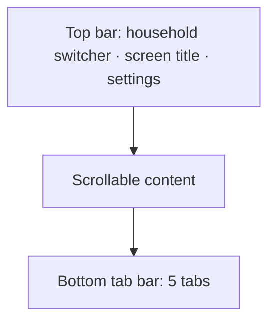

# Hearth — Design System and UI Specification

2026-09-17 · @Someone

Components, layout rules, and the full state matrix for every screen. Pairs with the Branding document, which owns color, type, and spacing tokens.

## Layout shell

Mobile-first. The phone layout is the primary design target; desktop is a widened variant, not a separate design.

### Chrome

**Top bar** — household name with a chevron on the left (opens the switcher), screen title centered or left-aligned depending on depth, settings or contextual action on the right. Sticky. On a detail screen, the household switcher is replaced by a back control.

**Bottom tab bar** — five tabs, each an icon plus label: Dashboard, Lists, Meals, Bills, Chores. The Lists tab is the Deals & Lists pillar. The active tab takes its section color; inactive tabs use `text-muted`. Fixed, with safe-area inset padding for notched devices.

**Sub-tabs** — four tabs have sections of their own, reached through a segmented control directly below the top bar:

| Tab | Sub-tabs | Root |
| --- | --- | --- |
| Lists | Lists · Deals · Flyers · Pantry | Lists |
| Meals | Planner · Recipes · Suggestions | Planner |
| Bills | Bills · Subscriptions | Bills |
| Chores | Chores · Errands | Chores |

The segmented control uses the tab's section color for the selected segment. Dashboard has no sub-tabs.

**Offline banner** — when offline, a persistent `Info`-colored strip sits directly below the top bar. It does not overlay content or shift the tab bar.

### Breakpoints

| Width | Layout |
| --- | --- |
| < 640px | Single column. Bottom tab bar. Full-width cards. |
| 640–1024px | Single column, max-width 640px, centered. Bottom tab bar retained. |
| > 1024px | Tab bar moves to a left sidebar with labels. Content max-width 960px. Two-column where a screen has a natural master/detail split (lists, recipes, bills). |

No layout below 320px is supported.

### Navigation rules

- Tab switches return to that tab's root sub-tab and screen but preserve scroll position per tab
- Detail screens push; a back control always returns to the originating list, not the tab root
- Switching household resets every tab to its root and clears cached per-household view state
- Modals are used only for destructive confirmation; everything else is a pushed screen or a bottom sheet
- Bottom sheets are used for quick add flows (add item, add errand) where the underlying context matters
- **Every swipe action has an overflow-menu alternative** (WCAG 2.5.1). A row with swipe actions also has a "More" button opening a menu with the same actions, so nothing requires a gesture.
- Tapping a notification opens its target screen in the notification's household, switching the active household first if needed

### Staged releases and the coming-soon state

Pillars ship across four releases, but the shell is complete from v1.0. All five tabs are present from the first release; a tab whose pillar has not shipped yet is visible and tappable, and opens a **coming-soon state** rather than being hidden or disabled.

That state uses the pillar's own section color and icon, names what the section will do in one line, and offers nothing to tap. Hiding the tab instead would mean the navigation visibly changes shape between releases, which reads as instability rather than progress.

The pillar's sub-tabs are part of what it offers, so they appear only once the pillar ships; until then every path under the tab, including a sub-tab deep link, shows the coming-soon state, and the top bar's title is the tab label. The one-line descriptions:

| Tab | Coming-soon line |
| --- | --- |
| Lists | "Shared shopping lists built from this week's deals at your stores." |
| Meals | "Plan the week's meals around what's on sale and in your pantry." |
| Bills | "Track bills and subscriptions and see what is due each week." |
| Chores | "Keep recurring chores and one-off errands on a shared schedule." |

The dashboard behaves the same way: its four cards are laid out from v1.0, with unshipped pillars showing a muted placeholder in their section color. A placeholder shows the pillar's icon and card title in its section color with the line "Coming soon", and, like the coming-soon state, is not a link. The layout never reflows as pillars arrive.

## Components

Built on **shadcn/ui** primitives (Radix under the hood, styled with Tailwind). Radix gives keyboard handling and ARIA wiring for free, which matters given the WCAG AA target. Components are copied into the repo rather than imported as a dependency, so they can be restyled to the section-color system.

### Primitives to configure

| Component | Variants | Notes |
| --- | --- | --- |
| Button | primary, secondary, ghost, destructive | Primary takes the active section's color. Min height 44px. |
| Input / Textarea | default, error | 16px text minimum. Outlined in `border-input`. Error state pairs red border with a message, never color alone. |
| Select | — | Radix Select; native on mobile where possible |
| Checkbox | default, in-list | In-list variant expands its hit area to the full row |
| Badge | neutral, section, warning, danger | Used for discount %, conditional price (coupon or card), "Personal", overdue |
| Card | flat, raised | Raised only on the dashboard |
| Sheet | — | Bottom sheet for quick-add flows |
| Dialog | — | Destructive confirmation only |
| Tabs | — | Week planner day selection |
| Segmented control | — | Sub-tab navigation within a tab (Radix Toggle Group, single selection) |
| Dropdown menu | — | Overflow ("More") menu; the non-gesture alternative to every swipe action |
| Skeleton | — | Replaces spinners wherever shape is predictable |
| Toast | success, error, info | Bottom-anchored above the tab bar. Success and info toasts dismiss after 4 seconds, and a toast with an Undo action stays for 5 seconds. Error toasts stay until dismissed. |

### Composite components

| Component | Used by | Contents |
| --- | --- | --- |
| `DealCard` | Deal search, flyer detail, suggestions | Image (from Flipp's CDN, with a neutral placeholder when absent or blocked), item name, merchant, unit price with its unit ("$2.49/lb", "$3.99"), the deal's own `displayPrice` copy beside it when it differs ("2/$5.00"), original price struck through, discount badge, conditional-price badge ("Coupon" or "Card") when flagged, validity dates, add-to-list action. Adding goes straight to the household's only list, or opens the same list picker the week planner uses when there is more than one. |
| `ShoppingListRow` | List detail | Checkbox (full-row target), item name, price with unit, quantity, store chip, added-by avatar, source icon. A repriced item shows the old sale price struck through beside the new price, or "No price" when the price was cleared |
| `StoreGroupHeader` | List detail | Merchant name, item count, running subtotal, and "+N unpriced" when N items are excluded from the subtotal |
| `RecipeCard` | Library, suggestions | Title, readiness percentage ring, bucket breakdown line, servings |
| `ReadinessBreakdown` | Recipe detail, suggestions | Per-ingredient bucket and what it matched. On recipe detail, each row also has an override control for wrong matches, and existing overrides are shown and removed inline. |
| `BillRow` | Bills dashboard | Name, amount, due date, autopay indicator, "Personal" badge for personal bills, overdue state, pay action, skip in the overflow menu |
| `ChoreRow` | Chores | Name, recurrence, next due, current assignee, last-completed relative time, complete action |
| `HouseholdSwitcher` | Top bar | Current household, list of memberships, add-household action |
| `DashboardCard` | Dashboard | Section-colored header, up to 3 items, count of remainder, tap to that section |

### Required states per component

Every interactive component specifies: default, hover, focus-visible, active, disabled, and loading where it triggers an async action. Focus-visible must be a 2px outline in the section color at 3:1 contrast against its background — never removed, never relying on the browser default.

## State patterns

Every screen implements all applicable states. A screen is not complete when only its populated state is built.

### The six states

| State | When | Pattern |
| --- | --- | --- |
| **Populated** | Data exists | The designed screen |
| **Empty (first run)** | Never had data | Icon in section color, one-line explanation, primary action button |
| **Empty (filtered)** | Data exists, filters exclude it | Different copy — "No deals match these filters" plus a clear-filters action. Never the first-run state. |
| **Loading** | Fetch in flight | Skeletons matching final layout. No spinners where shape is known. |
| **Error** | Fetch or write failed | Inline within the content area, not a full-screen takeover. States what failed and offers retry. |
| **Offline** | No connectivity | Cached content plus the offline banner. Queueable writes queue; every other write control is disabled with an inline explanation. |

### Loading rules

- Skeletons appear only after 200ms, so fast responses do not flash
- A skeleton mirrors the real layout: three list rows, not a grey box
- Never block the whole screen for a partial fetch — the dashboard renders each card independently as its data arrives
- Optimistic updates for every offline-queueable write; roll back visibly on failure with a toast

### Error rules

- Errors are scoped to the failing region. A failed deals fetch does not blank the dashboard's bills card.
- Every error offers either retry or a route forward. A dead end is never acceptable.
- **Stale-over-empty**: if cached data exists, show it with an "as of \[date\]" label rather than showing nothing. This is specifically important for deals, where the Flipp wrapper can fail without warning.
- Unexpected errors are sent to `POST /api/client-error` after scrubbing: route and ids only, never bill amounts, list contents, or anything else the scrubbing rules in Technical Architecture exclude

### Offline rules

- Read-only surfaces render from the persisted cache with no visual difference except the banner
- Only the writes the Requirements document lists as queueable work offline: list item add, check, uncheck, and edit (from v1.0), and chore complete and errand done (from v1.3)
- Every other write control is disabled while offline. Beside it sits one line of `text-secondary` explaining why ("Needs a connection."), and the control's accessible description carries the same text. A control is never hidden, and never fails silently.
- Queued writes show the affected row in a pending style (reduced opacity plus a small clock icon)
- Screens requiring live data (deal search, flyer browse) show a dedicated offline empty state: "Deal search needs a connection. Your lists still work."
- On reconnect, the queue replays and the banner is replaced by a 4-second success toast stating how many changes synced

### Deals-specific states

The deals pipeline has failure modes the rest of the app does not:

| Situation | Presentation |
| --- | --- |
| Flipp fetch failed, cache present | Cached results, "as of" date, subtle retry affordance |
| Flipp fetch failed, no cache | Error state with retry, plus a link to add list items manually |
| Cached, refreshing (dormant postal code) | Cached results with the "as of" label; results update when the refresh finishes |
| No cache, refreshing (dormant postal code) | "Fetching this week's deals…" over a skeleton of the results layout. The screen refetches automatically when the refresh finishes. If the refresh fails, it shows the error state with retry. |
| Fetch succeeded, high skip rate | Results shown normally; the skip count is logged, not surfaced to users |
| Household has no favorite stores | Prompt to pick favorites, with browse-all available immediately |
| Postal code returns no merchants | "No stores found near \[ZIP\]" plus an action to change the household postal code |

## Screens

Each entry gives layout, the primary action, and the states that differ from the universal patterns above.

### 1. Onboarding

Three steps: sign up or sign in with email and password, create or join a household, then set up the household (name, postal code, favorite stores). The household timezone is taken from the browser without asking. PWA install prompt appears after setup completes, and is mandatory messaging on iOS since notifications depend on it. It follows the join path too, since it concerns the app rather than the household.

The favorite-stores part of setup lists the merchants with an active flyer near the postal code the previous step set, each as a checkbox row, in the Lists section color. Picking none is allowed, since a household with no favorites is shown every merchant anyway and can choose later. The step's only other action is to continue; the postal code itself is corrected in Settings rather than here, so a ZIP that returns no merchants says so and continues.

- **Sign up:** email, display name, password. The password field shows the rule ("At least 8 characters") up front. A password on the common-password list gets an inline error: "That password is too common. Choose another."
- **Sign in:** email and password, with a "Forgot password?" link.
- **Forgot password:** a single screen with no form. "Ask your server owner for a reset link. They can create one for you." plus a back action.
- **Set new password:** opened by a reset link. New password field with the same rules, then it lands on the dashboard. An expired or used link shows "This reset link has expired. Ask your server owner for a new one."
- **Join:** by invite link, which opens the app with the invite applied after sign-in, or by entering the 8-character code. The code field accepts lowercase and ignores spaces and dashes. Joining skips household setup entirely and lands on the dashboard.
- **Magic link (flag-hidden):** built but hidden while `HEARTH_MAGIC_LINK_ENABLED` is false. A "Email me a sign-in link" option on sign-in opens a screen that takes an email address; sending it leads to the check-your-email confirmation, whose primary action opens the 6-digit code field, with a resend action enabled after 30s. The code field is the primary path, since an iOS home-screen app cannot receive the link's session. It is one field, not six boxes, so a code pasted with the spacing the email gave it lands whole. An incorrect or expired code gets a single sentence that does not separate the two ("That code is incorrect or has expired. Ask for a new one."), since neither may confirm whether an address has an account.

States: expired or revoked invite ("This invite has expired. Ask for a new link or code."), unrecognized code ("That code doesn't match an invite. Check it and try again."), rate-limited ("Too many attempts. Try again in a minute."), wrong password ("Email or password is incorrect.").

### 2. This Week dashboard — slate

Four cards, section-colored headers, stacked in fixed order: Bills, Shopping, Meals, Chores. Each shows up to three items plus a remainder count and routes to its section on tap.

- Bills card: due this week, overdue first with danger styling
- Shopping card: active list name, outstanding item count, a compact progress indicator
- Meals card: today's planned meal, then tomorrow's
- Chores card: due today and overdue

Bills include the user's personal bills, marked "Personal". "Today" and "this week" are evaluated in the household timezone, Sunday to Saturday.

Empty: a card with no items shows one line ("Nothing due this week") rather than disappearing, so the layout stays stable. When every *shipped* pillar is empty, a single first-run panel replaces those pillars' empty cards. Placeholders for unshipped pillars are unaffected and stay in place.

### 3. Household switcher

Sheet from the top bar. Current household checked, others listed with member count, then "Join or create a household". Single membership still shows the sheet, since it is also the route to adding one.

### 4. Settings

Grouped sections:

- **Account:** email, display name, and password, each editable; changing the email or password asks for the current password. The timezone is shown as detected and is read-only.
- **My Households:** each household with its role and member list, plus a leave action, and a "Join or create a household" action. The admin also sees remove-member and transfer-admin.
- **Invites** (admin only): create an invite, which shows the link (with a copy action) and the 8-character code once; a list of outstanding invites with creation and expiry dates; a revoke action on each.
- **Household settings** for the active household: favorite stores, editable by any member, chosen from the merchants near the postal code as the same checkbox list onboarding shows. Name, postal code, and timezone are editable by the admin and read-only for everyone else.
- **Notifications:** per-type toggles. Turning on the first type on a device asks for push permission and registers that device's push subscription. `weekly_meal_nudge` has its own toggle for each household. The single "Remind me about all household bills" toggle. The quiet-hours window, with start and end times. The per-type toggles ship with push itself and take the coming-soon state until then, since a switch that turns nothing on would be a lie; the quiet-hours window and the household-bill reminder live on the profile and are editable from the first release, and apply as soon as sending starts.
- **About:** version and sign out. Signing out removes this device's push subscription. For the server owner only, a **System health** entry opens a screen with job freshness (last deal refresh, last notification sent, last backup), the top errors from the last 24 hours, and per-merchant skip rates. Each item is plain text with an "as of" time; nothing on the screen is interactive beyond a refresh action.

**Leaving and removing.** Leave and remove both open a pushed screen with the departure preview: lists created, chores assigned, errands assigned, and household bills owned. Each item has a picker for a remaining member, and the confirm action stays disabled until every item has been reassigned. Below them, rotations are listed for information only, with no picker: "Take out trash: will be removed from rotation; the turn passes to Sam." When the departing user was viewing this household, the app switches to their longest-held remaining household, or to onboarding's create-or-join step if none is left. When the last member leaves, the preview is replaced by the household-deletion dialog. It names what will be lost, with counts ("This deletes 4 lists, 23 recipes, and 6 chores permanently"), and has a text field. The destructive button is enabled only when the field matches the household name exactly.

### 5. Deal search — green

Search field pinned below the top bar. Filter row beneath: store, category, price. Results as `DealCard` list, 50 to a page, with a previous-and-next pagination control that states the page and the total. Default scope is favorite stores; a toggle widens to all merchants.

The query and the price range are committed by submitting the search, so a half-typed price never becomes a request; store, category, and sort apply as they change. The store filter is one store within the current scope, and the category filter lists the categories present in the results, since the deals source has no category directory to offer. Every filter change returns to page 1.

States: no query yet (the favorite stores as shortcuts that set the store filter), filtered-empty, a query that matched nothing (which offers widening to all stores rather than clearing filters), offline (dedicated "needs a connection" state).

### 6. Browse flyers — green

Grid of active flyers for favorite stores, each showing merchant, validity dates, item count, and the same scope toggle deal search has. Tapping opens that flyer's items as a pushed screen, using the same `DealCard` list and the same pagination, with category filtering and the same sort.

### 7. Shopping lists — green

List of the household's active lists with name, item count, outstanding count, last activity. Primary action creates a list. Swipe to rename, archive, or delete, with the same actions in each row's overflow menu; delete requires confirmation ("Delete This Week? Its 15 items are removed permanently."). An "Archived" link at the bottom opens the archived lists, read-only, each with an unarchive action.

### 8. Shopping list detail — green

Items grouped by store with `StoreGroupHeader` showing a running subtotal per the Subtotals rule in the Requirements document, with "+N unpriced" when some items are excluded. Unassigned-store items group last under "Anywhere". Bought items collapse to a dimmed "Bought (7)" group at the bottom rather than disappearing. Repriced items show the old sale price struck through beside the new price.

Add via a bottom sheet: manual entry, or search deals inline. Each row's overflow menu holds edit (name, quantity, store, and price for manual items) and delete. Realtime: another member's changes animate in; their avatar appears on the changed row for 2 seconds.

States: offline with queued writes (pending rows dimmed with a clock icon), empty list, all-bought (celebratory only in the sense of a clear summary line — no confetti), archived (read-only, with an unarchive action).

### 9. Pantry — green

Flat searchable list of item names with an optional quantity note. Deliberately minimal. Primary action adds an item. Each row's overflow menu (and swipe) holds edit and delete. When a list reaches all-bought, the list offers "Add bought items to pantry", which adds them in one action.

### 10. Week planner — amber

Seven-day view, Sunday to Saturday. Mobile: day tabs with a single day's three slots visible. Desktop: full week grid. Each slot lists its placed recipes, since a slot can hold more than one, followed by an add affordance.

Placing a recipe opens a picker defaulting to deal-matched suggestions, with the full library searchable behind it. A placed meal shows title and readiness percentage. An entry whose recipe has since been deleted shows its snapshot title in `text-secondary` with no readiness and no link.

Each placed meal's overflow menu holds "Add missing to list" and remove. A week-level action adds the whole week's missing ingredients. Both open a list picker — always, with no single-list shortcut: unlike `DealCard`'s inline add, these three entry points (recipe, meal, week) target a plan-level scope rather than one item, so the picker is the one interaction to keep consistent across all three, per Requirements' "Add missing to list".

### 11. Recipe library — amber

Searchable list with readiness percentage on each card. Sort by recently added, title, or readiness. Add flow: paste URL (parse, then show an editable preview) or manual entry. In the preview, each ingredient shows its original line, with quantity, unit, and item name as editable fields beneath it, so a bad split can be corrected before saving.

States: parse in progress, parse failed ("Couldn't read that page. Add it by hand?" with fields prefilled where partial data was extracted), parse succeeded but incomplete (flag missing fields in the editable preview rather than saving silently).

`GET /households/:id/recipes` (Technical Architecture › "API surface") carries no readiness — only `GET /households/:id/suggestions` computes it, for every recipe including 0% ones. The library's readiness and bucket-breakdown line come from joining that response onto the recipe list client-side by `recipeId`, rather than adding a field to the recipes endpoint. Recipes paginate at 50, the same as deals (Requirements › "Scale and pagination"), and this screen carries the same previous-and-next `Pagination` control deal search uses, so a household past the first page can still reach every recipe rather than the extra ones silently going missing. Sort and the search field both act on the page currently loaded, not the whole library — the recipes endpoint has no search of its own to filter server-side — so a new search returns to page 1.

### 12. Recipe detail — amber

Title, servings, source link, `ReadinessBreakdown`, ingredients, instructions. Each ingredient shows its bucket with an icon and label, and what it matched. A wrong match can be corrected inline: "Not a match" stores a force-no-match override, and "Match to…" picks a pantry item or current deal and stores a force-match override. Overrides apply to the whole household. An ingredient governed by an override shows a small "Corrected" label with a remove action.

Primary action: add missing ingredients to a list. Secondary: place on the week planner, which opens a sheet asking for the date and the meal slot (breakfast, lunch, or dinner), defaulted to today and dinner. The overflow menu holds edit, which opens the same editable form as the add flow, and delete, which asks for confirmation ("Delete Baked Ziti? Planned meals keep its name.").

"Match to…" has no endpoint that lists every current deal (Technical Architecture only offers a keyword search), so its deal half searches the household's favorite-merchant deals by keyword, prefilled with the ingredient's own name but editable — a member can retype it, since the right deal's product name often shares none of the ingredient's tokens (the same 0.85 token-similarity limit "on sale" scoring itself runs into) — rather than a new listing endpoint; its pantry half lists the household's pantry in full, since that endpoint already exists.

### 13. Deal-matched suggestions — amber

Recipes ranked by readiness descending, each with the bucket breakdown line. A header states the deal week the scoring is based on and its as-of date.

States: no recipes yet (routes to the library), no deals available ("Suggestions need this week's deals" with retry), all recipes at 0% (shown normally, ranked by title — not treated as empty).

### 14. Bills dashboard — blue

Grouped by Overdue, This week, Later. The primary action adds a bill; the form's visibility choice (Household or Personal) decides whether it belongs to the household or to the user alone. Shows the active household's bills plus the user's personal bills, which carry a "Personal" badge. Each `BillRow` shows name, amount, due date, autopay indicator, and visibility. Marking paid writes to the payment log for the current occurrence. An unpaid occurrence stays in Overdue until it is paid or skipped. Skip is in the overflow menu and asks for confirmation ("Skip the March 12 Duke Energy bill? It won't be marked paid."). Autopay payments appear in the history automatically, labelled "Autopay".

Empty: first-run panel explaining that Hearth tracks bills but never pays them.

### 15. Bill detail — blue

Form fields plus payment history. Recurrence editing (unit, interval, first due date) shows a plain-language preview of the next three due dates, since anchored recurrence is easy to misunderstand. Reminder lead time in days (default 3). Payment history entries can be edited or removed, including automatic ones. The overflow menu holds archive and delete.

**Bill sheet** (create and edit, as a pushed screen):

- name
- amount (dollars; stored and transmitted as integer cents)
- category (free text, optional)
- visibility: Household or Personal — set only when adding a bill; a bill's owner cannot move it between household and personal afterward
- recurrence editor: unit (day, week, month, year, or none for a one-time bill), interval, and first due date (anchor date), with the plain-language next-three-dates preview described above
- autopay (on/off)
- reminder lead time in days (default 3)
- "Track as a subscription" (on/off) — includes the bill in the Subscriptions view (Screen 16); off by default

A bill's visibility is fixed once created, so the edit form omits that field and shows it as read-only context instead.

### 16. Subscriptions — blue

Total monthly figure at top, normalized per the Requirements document. Then the active household's subscriptions and the user's personal subscriptions ("Personal" badge), sorted by monthly cost descending, with the annualized figure (monthly amount × 12, per the Requirements document) on each row. Items unconfirmed for 60+ days show a "Still using this?" prompt inline with two actions: "Still using", which resets the clock, and "Stop tracking", which archives the bill.

### 17. Chores — purple

Grouped by Overdue, Today, This week, Later. Each row shows recurrence, next due, assignee, and last-completed relative time. Rotation chores show whose turn it is and who is next. The primary action adds a chore.

Each row's name opens the chore's detail. Its complete action is a separate control, labelled "Done" with the accessible name "Mark <chore name> done", so the name and the action are two tab stops rather than one control nested in the other. The last-completed time is measured from the calendar day the completion was made, in the household timezone, not from the occurrence it closed, so a chore finished early today reads "Last done today".

**Chore sheet** (create and edit, as a pushed screen):

- name
- recurrence editor: unit (day, week, month, year), interval, and anchor date. The anchor defaults to today for a new chore. A plain-language preview of the next three occurrence dates updates as the fields change. The preview counts from the anchor, so an anchor in the past shows the occurrences that began at it ("Occurs on …"), which is what the recurrence rules compute.
- assignment, as either a rotation or a single member. A rotation is an ordered list of members, reorderable by drag handles with up and down buttons as the non-gesture alternative; moving a member to the top or bottom disables the button that would go further, and focus moves to the member's other button, so a keyboard user keeps their place. A rotation needs at least one member: saving an empty one is refused inline with "Add at least one member to the rotation." A single member sets `assigned_to`; the single-member choice offers "Unassigned" as an explicit option, so an assignee can be cleared as well as set.
- delete, in the overflow menu, with confirmation

**Chore detail**, opened by tapping a row, shows the recurrence summary, the next three dates, the rotation order, and the completion history with who completed each occurrence and when; departed members show as "Former member". Each history entry also names the occurrence it closed ("For 09/20/2026"), so an early or late completion is legible. The most recent completion has a delete action, with confirmation.

Completing closes the current occurrence, or the upcoming one when done early, and advances the rotation. The completion toast ("Take out trash done. Sam is next.") offers Undo for 5 seconds; undoing deletes the completion and the next due date and rotation revert. An occurrence that was never completed stops showing as overdue once the next occurrence's date arrives. Explicit non-nagging tone: overdue uses danger color but neutral copy.

### 18. Errands — purple

Flat list, open items first, done collapsed below with who completed each and when. The primary action is quick-add, via a bottom sheet with optional due date and assignee; the assignee choice offers "Unassigned" explicitly, as the chore sheet does. Tapping an errand opens the same sheet for editing; its overflow menu holds delete.

An open errand past its due date reads "Overdue N days" in the danger color, as an overdue chore does, so the word carries the state and the color only reinforces it. Its checkbox toggles done; while offline it is disabled, with "Needs a connection." beneath the errand's name, and the checkbox's accessible description carries the same line.

## Accessibility

**WCAG 2.1 Level AA is the target**, and it is treated as an acceptance criterion rather than a nice-to-have.

### Requirements

| Area | Requirement |
| --- | --- |
| Contrast | 4.5:1 body text, 3:1 large text and UI boundaries, verified in both themes |
| Color independence | Every state carrying meaning through color also carries an icon or text label |
| Keyboard | Full operation without a pointer; visible focus on every interactive element; logical tab order |
| Focus management | Sheets and dialogs trap focus and return it to the trigger on close; where a member's action replaces the control they used — a form giving way to its confirmation, a button giving way to the form it opens — focus moves into what replaced it rather than falling back to the document |
| Touch targets | 44×44px minimum, with at least 8px between adjacent targets |
| Screen readers | Semantic HTML first; ARIA only where semantics fall short |
| Motion | All animation respects `prefers-reduced-motion` |
| Zoom | Usable to 200% zoom without horizontal scrolling |
| Forms | Every input has an associated label; errors announced and programmatically linked to their field |
| Gestures | Every swipe action has a single-pointer alternative in an overflow menu (2.5.1) |

### Specific patterns

- **Live regions** for realtime list changes, announced politely so a screen-reader user hears when another member adds an item. A region that will announce a later change is in the tree before it has anything to say, and while empty is hidden in a way that keeps it in the accessibility tree rather than with `display: none`, because a region that arrives already populated is announced unreliably
- **Skip link** to main content, visible on focus
- **Readiness percentages** are announced as "4 of 5 ingredients ready", not just a number, and the ring visual is `aria-hidden` with the text carrying the meaning
- **Deal cards** announce price and discount as a sentence, not as disconnected fragments
- **Checkbox rows** use a real checkbox input with the row as its label, so it is announced correctly rather than as a clickable div
- **Overdue states** include the word "overdue" in the accessible name, not just red text
- The offline banner uses `role="status"` so it is announced without stealing focus

### Verification

Automated checks with `axe-core` run in the Playwright E2E suite on every screen in both themes. Automated testing catches roughly half of real issues, so manual keyboard-only and screen-reader passes are required before each pillar is considered done.
