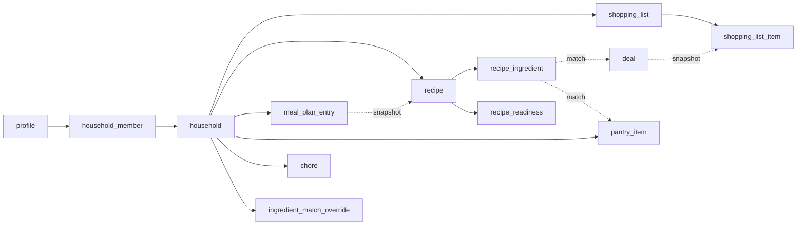
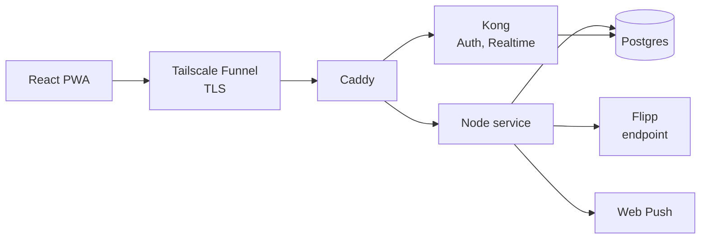

# Hearth — Product Requirements Document

2026-09-17 · @Someone

## Overview

Hearth consolidates the recurring administrative work of running a home into one self-hosted app: grocery deals, meal planning, bills, and chores, shared across a household and installable as a PWA.

The work of running a household is spread across too many surfaces. Weekly grocery ads live in a separate app or circular per store, with no way to compare them. Meal planning happens independently of what is on sale, so savings go unclaimed. Subscriptions accumulate quietly across autopay accounts. Chores are tracked in someone's head or not at all. Each is individually minor; together they are a persistent tax on time, and no existing tool covers more than one.

### Goals

- **Consolidate.** Four domains that share data, not four tools stapled together.
- **Make savings automatic.** Deal data feeds meal planning and shopping lists directly, so the economical choice is the default path rather than a research project.
- **Built for a household.** Shared lists and chores with real-time sync between members, designed for sharing from day one.
- **Free to host.** Runs on owned hardware and is reached through Tailscale Funnel. No domain, no paid service, no SMTP relay, no metered third-party API.

### Non-goals for v1

- Price history or trend analysis over time
- Automated bill payment or any financial account linkage
- Publishing recipe or deal content of its own; Hearth aggregates and organizes
- Operation at public scale. Anyone who can reach the server may sign up, but the system is sized for a handful of households.

## Users and scope

All four pillars ship in v1. This is a substantial scope rather than a minimal one, so build order is sequenced in the final section even though nothing is cut.

### Users

- **Primary:** a CS student, graduating in roughly a year, who owns the hardware and self-hosts the deployment. This person is the **server owner**: the account whose email equals `HEARTH_OWNER_EMAIL` in the host's `.env`. Only the server owner sees Settings → About → System health and can reset passwords.
- **Secondary:** other household members (roommates, family) who use the app but never touch the infrastructure. They need frictionless login and no configuration.

### The four pillars

| Pillar | Core value | Depends on |
| --- | --- | --- |
| Deals & Lists | All local weekly ads in one filterable place, with per-store lists | Flipp wrapper service |
| Meal planning | Weekly meal plan weighted toward what is on sale and already in the pantry | Deals data, pantry, recipes |
| Bills and subscriptions | One view of what is due and what recurring spend has crept in | None |
| Chores and errands | Recurring chores with rotation, plus one-off errands | None |

### Scope decisions made

- Chores are purely functional; no streaks, points, or gamification.
- Deal-matched recipe suggestions are core to v1, not deferred.
- Recipe import supports both URL auto-parsing and manual entry.
- Quiet hours ship in v1 as a per-user setting.

## Core concepts

The household is the unit of sharing, and households are fully isolated from one another. A user may belong to several.

### Multi-household membership

Membership lives entirely in a join table, so a user can belong to any number of households — for example one with roommates and one with family. The `profile` record carries no membership.

Most screens operate on a single household at a time. The currently selected household is stored server-side as `profile.active_household_id` and is therefore the same on every device the user signs in on. Switching is a full context swap rather than a merged view. Tapping a notification opens the household the notification belongs to and makes it the active household. When a user leaves or is removed from their active household, the active household becomes their longest-held remaining membership (earliest `joined_at`). If they have no membership left, it becomes null, and the app opens onboarding's create-or-join step.

### Data isolation

Every household-scoped entity — shopping lists, pantry, recipes, meal plans, match overrides, chores, errands, favorite stores, invites, and household-visibility bills — belongs to exactly one household. There is no cross-household view, no shared list that spans households, and no aggregate dashboard across them.

No endpoint returns another household's data. There are exactly two exceptions to single-household responses, and both belong to the caller: the caller's own membership list, which the household switcher needs, and the caller's own personal bills. Personal bills hang off `owner_user_id`, belong to no household, and appear in every household context the owner opens (the Bills tab and the dashboard), marked "Personal". No other member ever sees them.

### Joining a household

Only the household admin creates invites. An invite consists of two credentials, both stored only as hashes:

- an opaque random token, carried in a shareable link
- an 8-character code a person can type, drawn from the Crockford Base32 alphabet (no I, L, O, or U)

The admin can view a list of outstanding invites for the household. An invite can be redeemed any number of times until the admin revokes it or it expires 7 days after it was created. It can be redeemed during signup, or by a signed-in user adding another household from Settings. A household admin can also remove a member, and any member can leave on their own. Removal deletes the membership row, and row-level security ends that user's access immediately.

### Permissions

Household content is flat. Any member may create, edit, and delete lists, list items, recipes, meal-plan entries, pantry items, match overrides, chores, errands, household bills, and favorite stores.

The following are admin-only:

- membership: creating and revoking invites, removing members, and transferring the admin role
- the household's name, postal code, and timezone

### Household timezone

When a household is created, `household.timezone` is set from the creator's browser. After that, only the admin can change it.

Dates that belong to the household are evaluated in the household timezone: chore occurrence dates, errand due dates, household-bill due dates, meal-plan dates, and what counts as "today" in any household view. Dates that belong to a person are evaluated in that person's `profile.timezone`: personal-bill due dates, quiet hours, and user-scheduled notification times. `profile.timezone` is detected from the browser and refreshed every time the app opens, not only at sign-in.

## Deals & Lists

The anchor feature: every local store's weekly ad in one filterable view, feeding shared per-store shopping lists. The pillar's tab is labelled **Lists**.

### Deal search and browse

- Search by item keyword across every store near the household's ZIP code
- Filter by store, category, and price range; sort by relevance or price
- Browse mode: list every active weekly flyer near the ZIP, then drill into one flyer's full contents
- Each deal shows item name, sale price with its unit (each, /lb, /oz), original price where available, discount, store, and the dates the deal is valid
- A deal whose price depends on a digital coupon or a loyalty card carries a conditional-price badge naming which it is

### Shopping lists

- A household may keep several lists; the common case is one per week
- Items are added from a deal result, from a recipe's ingredients, from a meal plan, or typed manually
- Every item carries a status: needed, in cart, or bought
- Items record who added them, so a shared list stays legible
- An item added from a deal takes a snapshot of that deal (merchant, sale price, price unit, validity, conditional flag). It does not hold a live reference to the deal, because Flipp item ids change every week.

### Per-store splitting

A list groups its items by store, so the shopper knows what to pick up where. Items sourced from a deal carry their store (`merchant_id` and `merchant_name`) automatically; manually added items can be assigned a store or left unassigned. Each store group shows a subtotal, computed per the Subtotals rule.

### Real-time sharing

List changes sync live to every household member. If one person checks off milk while standing in the aisle, another member sees it immediately. This is the single most latency-sensitive surface in the app and the main justification for a realtime backend.

### Pantry

A lightweight inventory of what the household already has. It exists mainly to feed the meal-planning readiness score and to avoid buying duplicates; it is not a full inventory system and does not track quantities precisely. An item is a name, with an optional free-text quantity note that the household writes for itself.

The bought items on a list can be added to the pantry in one action. Each becomes a pantry item under its `normalized_name`: a name already in the pantry is refreshed rather than duplicated, and one that is not is added. A list quantity does not follow the item into the pantry — it is how much was bought this week, not what is in the cupboard, and the pantry deliberately does not do quantity arithmetic. The bought items stay on their list.

## Meal planning

Meals are planned against what is on sale this week and what is already in the pantry. The deal-matching is core to v1, not a later addition.

### Recipe library

- Import by pasting a URL: the service parses schema.org / JSON-LD recipe markup, which most recipe sites publish
- Manual entry as fallback when parsing fails or no URL exists; the parse result is always editable before saving
- Each recipe stores title, source URL, instructions, servings, and a list of ingredients with quantity and unit
- JSON-LD ingredients are free-text lines ("2 cups chopped yellow onion"). Each line is split into quantity, unit, and item name by an ingredient-line parser library. The original line is kept in `recipe_ingredient.raw_text`, and the user can correct the split in the editable preview before saving.
- Servings are recorded as published and never scaled

### Week planner

A seven-day grid, Sunday through Saturday. Recipes are placed onto a day and meal slot (breakfast, lunch, dinner), and a slot may hold more than one entry. Any household member can add to the plan.

Each entry snapshots the recipe's title into `meal_plan_entry.recipe_title` when the recipe is placed. If the recipe is deleted later, the entry remains and shows the snapshot title (see Meal plan history and deleted recipes).

The missing ingredients of a single recipe, a single planned meal, or a whole planned week can be added to a shopping list in one action, per the Add missing to list rule.

### Deal-matched suggestions

For each recipe, every ingredient falls into exactly one bucket:

| Bucket | Meaning |
| --- | --- |
| In pantry | Matches one of the household's pantry items |
| On sale | Matches a current deal from one of the household's favorite merchants, and matches no pantry item |
| To buy | No match either way; buy at regular price |

An ingredient that matches both the pantry and a deal goes into the pantry bucket and is counted once. Only deals from the household's favorite merchants whose `valid_to` has not passed count toward the On sale bucket.

The readiness score is the share of ingredients already covered:

`readiness = (on_sale + in_pantry) / total_ingredients`

The score is displayed as a whole-number percentage, rounded half-up. A recipe with no ingredients scores 0%. Suggestions are ranked by readiness, highest first. **On-sale and in-pantry ingredients are weighted equally in v1**: a recipe with 4 of 5 ingredients ready outranks one with 3 of 5, whichever buckets the covered ingredients came from. Equal weighting keeps the score simple to explain in the UI; revisit after real use.

Readiness is precomputed on the server and stored in `recipe_readiness`. It is recomputed for the affected household after every deal refresh and whenever a pantry item, recipe, or match override changes.

### Matching mechanics

Matching lives in the `matching` package, in TypeScript. It is not done in SQL.

- **Normalization**, applied to both sides: lowercase; strip punctuation, quantities, and units; strip terms on a maintained descriptor list ("boneless", "skinless", "family pack", "chopped", …) and a maintained brand list ("Kraft", "Barilla", …); singularize each remaining token, then apply the descriptor and brand lists once more, so that a plural descriptor ("Sandwich Bags") is stripped now that it reads as "bag" and normalizing a normalized name changes nothing. If nothing is left after this, the normalized name falls back to the lowercased original with only punctuation stripped. For example, "Coca-Cola 2L" loses its brand and its size, so it normalizes to "coca cola 2l". `normalized_name` is precomputed and stored whenever an ingredient, pantry item, deal, or list item is saved.
- **Token containment:** an ingredient matches a candidate when every token of the ingredient's normalized name fuzzy-matches some token of the candidate's normalized name with a similarity of at least **0.85**. "chicken breast" does not match "chicken broth", because "breast" has no match in the candidate.
- **Overrides** apply before fuzzy matching (see Match overrides).
- Which fuzzy-similarity library to use (`fastest-levenshtein` or `fuse.js`) is decided by a Phase 3 benchmark on real deal strings.

### Match overrides

A wrong match (or a missed one) can be corrected from the recipe's breakdown. The correction is stored in `ingredient_match_override`. Each override names:

- the ingredient's normalized name
- the target kind (deal or pantry) and the target's normalized name
- a decision: force match or force no-match

An override applies to every recipe in the household. It stays in effect until a member removes it. A force match puts the ingredient in the target's bucket whenever a target with that normalized name exists; a force no-match prevents that pair from matching.

`POST /households/:id/match-overrides` takes the ingredient's and target's plain names, not pre-normalized strings: the service normalizes both itself through `@hearth/matching`, the same as every other `normalized_name` in the system, rather than trusting a client-supplied normalized form. Creating an override for a (household, ingredient, target kind, target) that already has one updates its decision in place, the same idempotent-POST pattern as `favorite-stores` and the pantry, rather than failing with a conflict.

### Transparency

A suggestion card shows the breakdown, not just the number: "4 of 5 ready — 2 on sale, 2 in pantry, 1 to buy". Opening the recipe shows which specific ingredient landed in which bucket, so a wrong fuzzy match is visible and correctable rather than hidden inside a score.

## Bills and subscriptions

One view of what is due and what recurring spend has crept in. Tracking only — Hearth never moves money or connects to a financial account.

### Bills

- A bill has a name, an amount, a category, a recurrence (see Recurrence), an autopay flag, and a reminder lead time (`reminder_days_before`, default 3).
- The Bills tab and the dashboard sort bills by soonest due date and flag any occurrence that is past its due date and still unpaid.
- **An unpaid occurrence stays overdue** until someone either records a payment for it or explicitly skips it. It never rolls forward by itself. A skip records that the occurrence will not be paid (for example, a waived month).
- A payment log records each occurrence's payment date and amount, giving history rather than only a next-due date.
- **Autopay bills log their own payments.** Once an occurrence's due date begins in the bill's timezone, an automatic payment is recorded for the bill's amount, flagged `is_auto`. This applies only to occurrences dated on or after the date the bill was created (`created_at`, in the bill's timezone). An earlier occurrence with no log row follows the normal rule and stays unpaid and overdue until someone pays or skips it. Any member who can see the bill can edit or remove an automatic payment. Reminders for autopay bills still fire, labelled "autopay".
- A bill that is no longer needed is archived. Archiving hides it from every view and stops its reminders, and its payment history is kept.

### Visibility

Each bill is either **household** or **personal**:

- Household bills (rent, utilities) are visible to every member of that household
- Personal bills (a streaming subscription) belong to `owner_user_id`, sit outside any household, and are visible only to their owner — which matters because a user may belong to several households. They appear in every household context their owner opens, marked "Personal".

### Subscriptions view

Bills flagged `is_subscription` get their own view. It shows the active household's subscriptions plus the viewing user's own personal subscriptions, sorted by monthly cost.

The view's total is a monthly figure. Each bill is converted to a monthly amount from its recurrence unit and interval:

| Recurrence unit | Monthly amount |
| --- | --- |
| Week | amount × 52 ÷ 12 ÷ interval |
| Month | amount ÷ interval |
| Year | amount ÷ 12 ÷ interval |
| Day | amount × 365 ÷ 12 ÷ interval |

The total is rounded half-up to cents. Each row's annualized figure is its monthly amount × 12.

A subscription whose usage has not been confirmed for 60 days shows a "Still using this?" prompt. The clock runs from `last_used_confirmed_at`, or from `created_at` if usage has never been confirmed. The prompt has two actions:

- **Still using** sets `last_used_confirmed_at` to now, which resets the clock.
- **Stop tracking** archives the bill.

Usage is self-reported through the prompt; Hearth has no way to detect actual usage.

### Reminders

The bill's owner gets `bill_due` reminders by default. A reminder is sent `reminder_days_before` days before the due date, and again on the due date if the occurrence is still unpaid. Any other member can turn on a single per-user setting, **"Remind me about all household bills"** (`profile.household_bill_reminders`). That member then gets the same reminders for every household bill in every household they belong to. There is no per-bill opt-in.

## Chores and errands

Purely functional tracking. No streaks, points, or gamification — the goal is visibility into what has and has not been done, not motivation mechanics.

### Recurring chores

- A chore has a name and a recurrence (see Recurrence). A custom interval such as "every 3 days" uses unit day, and its anchor defaults to the date the chore was created.
- Optional rotation: an ordered list of household members that advances on each completion, so the system answers "whose turn is it" rather than an argument. A chore without a rotation may be assigned to one member (`assigned_to`) or left unassigned.
- A completion records who did it and when, and the occurrence it closes. "When" is the moment the member acted, even when the completion is sent later from the offline queue; a time in the future is never stored.
- A completion can be undone. The completion toast offers Undo for 5 seconds, and the chore's history offers delete on its most recent completion. Only the most recent completion can be deleted. The next due date and the rotation are derived, so both recompute on their own.
- Offline, a completion's occurrence is worked out on the device from the household's today and the completions the device holds. The full history is held once a chore's detail has been opened; until then the device holds only the chore's most recent completion, and the occurrence is placed from that. A completion placed from less history than the server holds is refused when it is sent, and the refusal is reported as a change that could not be saved, with no household content.
- Chore and errand screens date everything in the household's timezone. Until the household's details are known, on this device or from the network, they show their loading or offline state rather than dated rows, so a day is never read from the device's own zone.
- The list shows when each chore was last completed, so "this has not been done in three weeks" is visible without anyone having to nag. That time is the calendar day the completion was made, in the household timezone, not the occurrence it closed: a chore completed early for next week still reads as done today.

### Errands

One-off tasks with a name, an optional due date, and a status of open or done. Any member can add one; assignment to a specific member is optional. Marking an errand done records `completed_at` and `completed_by`. Marking a done errand open again clears both — the schema's check constraint already requires the two fields to move together in either direction, and an errand can be reopened the same way a bought list item can move back to needed. Marking an errand done offline queues it, with the moment it was made; reopening is online-only. Marking an errand done that is already done changes nothing, so a replayed done is harmless.

### Chore notifications

See Notifications for `chore_due` and `chore_rotation`.

## Dashboard and navigation

### This Week

The home screen, and the thing that makes Hearth one product rather than four. It pulls the most immediate item from each pillar into a single view for the active household. "Today" and "this week" are evaluated in the household timezone, and the week runs Sunday to Saturday.

- Bills due this week (household bills plus the user's personal bills), flagged if overdue
- Today's planned meals, then tomorrow's
- Active shopping list status (items outstanding)
- Chores due, and any overdue

### Navigation shell

A bottom tab bar suited to mobile: **Dashboard · Lists · Meals · Bills · Chores**. Settings and the household switcher live in the top bar. The sub-tabs within each tab are specified in the Design document.

The household switcher displays the active household name and, on tap, lists every household the user belongs to. Switching swaps the entire app context and updates `profile.active_household_id`.

## Data model

Postgres. Every household-scoped table carries `household_id` and is gated by row-level security. Money columns are `numeric(10,2)`. Dates without a time component are `date`; timestamps are `timestamptz`, stored in UTC. Recurrence uses the same three fields on `bill` and `chore`: `recurrence_unit` (day/week/month/year), `interval` (positive integer, default 1), and `anchor_date`.

### Users and households

| Table | Fields |
| --- | --- |
| `profile` | id (= `auth.users.id`), email, display\_name, timezone, active\_household\_id (nullable, `ON DELETE SET NULL`), quiet\_hours\_start (time, nullable), quiet\_hours\_end (time, nullable), household\_bill\_reminders (boolean, default false), created\_at |
| `household` | id, name, postal\_code, timezone, last\_active\_at, created\_by, created\_at |
| `household_member` | user\_id, household\_id, role (admin/member), joined\_at |
| `household_invite` | id, household\_id, token\_hash, code\_hash, created\_by, created\_at, expires\_at, revoked\_at (nullable) |

`profile` has a 1:1 relationship with `auth.users`. A trigger on `auth.users` creates the profile row at signup, copying `display_name` and `timezone` from the signup's `user_metadata`, and keeps `email` in sync. Signup passes the browser's timezone; a missing or unknown timezone falls back to `UTC` until the app's next open replaces it, and a blank display name falls back to the part of the email before the `@`. `quiet_hours_start` and `quiet_hours_end` are either both set or both null. `profile.timezone` and `household.timezone` are always timezone names Postgres recognizes. The table is not called `user` because that is a reserved word in Postgres.

`household.last_active_at` is updated by the service on the first member request against the household each day. It decides which postal codes the daily deal refresh covers.

`household_member` is the only place membership lives; a user has one row per household they belong to. Each household has exactly one row with role admin; a partial unique index enforces at most one, and the membership functions keep at least one.

`household.postal_code` is a five-digit US ZIP code, required when the household is created. `household_invite` stores each credential as its SHA-256 digest in lowercase hex, and its `expires_at` is always exactly 7 days after `created_at`.

### Deals

| Table | Fields |
| --- | --- |
| `deal` | id, external\_id, merchant\_id, merchant\_name, name, normalized\_name, unit\_price, price\_unit (each/lb/oz), original\_price (nullable), discount\_percent (integer, nullable), display\_price, conditional\_price (boolean), conditional\_reason (coupon/loyalty\_card, nullable), category (nullable), image\_url (nullable), source\_url (nullable), flyer\_id, postal\_code, valid\_from, valid\_to, fetched\_at |
| `deal_query_cache` | postal\_code, normalized\_query, deal\_ids (uuid array), cached\_at |
| `postal_code_refresh` | postal\_code (primary key), last\_refreshed\_at (nullable), last\_on\_demand\_at (nullable) |
| `household_favorite_store` | id, household\_id, merchant\_id, merchant\_name |

`deal` holds normalized deals that are currently valid, unique on (`postal_code`, `external_id`). Flipp's identifiers (`external_id`, `merchant_id`, `flyer_id`, and the snapshot's `deal_external_id`) are opaque text, as the wrapper's contract types them. `conditional_reason` is set exactly when `conditional_price` is true. It is not a historical record; rows are pruned once `valid_to` has passed. `deal_query_cache` records which deals a live search returned, keyed on (`postal_code`, `normalized_query`), so that repeated searches don't re-hit Flipp while the TTL lasts. `postal_code_refresh` records when each postal code's flyers were last refreshed, and when it last had an on-demand refresh.

`household_favorite_store` is unique on (`household_id`, `merchant_id`).

Favorites scope the default deal search, the flyer list, the daily flyer-item refresh, readiness matching, and the `flyer_refresh` notification. Browsing every merchant near the postal code remains available regardless.

### Shopping and pantry

| Table | Fields |
| --- | --- |
| `shopping_list` | id, household\_id, name, archived\_at (nullable), created\_by, created\_at, updated\_at |
| `shopping_list_item` | id (client-generated UUID), list\_id, item\_name, normalized\_name, quantity (numeric, nullable), quantity\_note (nullable), status (needed/in\_cart/bought), added\_by, source (manual/from\_deal/from\_recipe), merchant\_id (nullable), merchant\_name (nullable), deal\_external\_id (nullable), sale\_price (nullable), regular\_price (nullable), deal\_valid\_to (nullable), price\_unit (each/lb/oz, default each), conditional\_price (boolean, default false), price (nullable), original\_sale\_price (nullable), repriced\_at (nullable), contributing\_recipe\_ids (uuid array), created\_at |
| `pantry_item` | id, household\_id, item\_name, normalized\_name, quantity\_note, last\_updated |

The deal fields on `shopping_list_item` are a snapshot taken when the item is added: `sale_price` is the deal's `unit_price`, and `regular_price` is its `original_price`. `price` is the price the item currently counts at: the sale price while the deal is valid, or the repriced value after that (see Expired deal repricing). A manually added item may have a `price` and `price_unit` entered by hand. `shopping_list.updated_at` is bumped by any change to the list or its items (a trigger does it), and is shown as the list's last activity. `pantry_item` is unique on (`household_id`, `normalized_name`), so adding an item the pantry already has updates it rather than duplicating it.

### Meal planning

| Table | Fields |
| --- | --- |
| `recipe` | id, household\_id, title, source\_url, instructions, servings, created\_by, created\_at |
| `recipe_ingredient` | id, recipe\_id, position, raw\_text (nullable), item\_name, normalized\_name, quantity (nullable), unit (nullable) |
| `recipe_readiness` | recipe\_id (primary key), household\_id, on\_sale\_count, in\_pantry\_count, to\_buy\_count, readiness\_percent (integer), breakdown (jsonb: per ingredient id, its bucket and the matched deal or pantry name), computed\_at |
| `ingredient_match_override` | id, household\_id, ingredient\_normalized\_name, target\_kind (deal/pantry), target\_normalized\_name, decision (force\_match/force\_no\_match), created\_by, created\_at |
| `meal_plan_entry` | id, household\_id, recipe\_id (nullable, `ON DELETE SET NULL`), recipe\_title, planned\_date, meal\_type (breakfast/lunch/dinner), added\_by, created\_at |

`ingredient_match_override` is unique on (`household_id`, `ingredient_normalized_name`, `target_kind`, `target_normalized_name`). `recipe_readiness` is derived data. The service rewrites it; users never edit it directly. `recipe_readiness` and `meal_plan_entry` reference their recipe together with its `household_id`, so neither can point at another household's recipe.

### Bills

| Table | Fields |
| --- | --- |
| `bill` | id, household\_id (nullable), owner\_user\_id, name, amount, category, recurrence\_unit (day/week/month/year, nullable for a one-time bill), interval, anchor\_date, reminder\_days\_before (default 3), autopay, visibility (household/personal), is\_subscription, last\_used\_confirmed\_at (nullable), archived\_at (nullable), created\_at |
| `bill_payment_log` | id, bill\_id, occurrence\_date, paid\_date (nullable), amount\_paid (nullable), is\_auto (boolean, default false), is\_skipped (boolean, default false), recorded\_by (nullable; null for automatic payments), created\_at |

`bill` has a check constraint: `visibility = 'personal'` exactly when `household_id` is null. That constraint is what keeps personal bills out of every household's data. Only a bill's owner can change its visibility, which moves it between the household and the owner alone, and a household bill never moves to another household. A household bill's owner must be a member of its household when the owner is set. The next due date is not stored; it is derived from the recurrence fields and the payment log (see Recurrence).

`bill_payment_log` is unique on (`bill_id`, `occurrence_date`). A row either records a payment (`paid_date` and `amount_paid` set) or a skip (`is_skipped` true, `paid_date` and `amount_paid` null); a check constraint enforces exactly one of the two.

### Chores

| Table | Fields |
| --- | --- |
| `chore` | id, household\_id, name, recurrence\_unit (day/week/month/year), interval, anchor\_date, rotation\_order (user\_id array, nullable), rotation\_offset (integer, default 0), assigned\_to (nullable), created\_by, created\_at |
| `chore_completion` | id (client-generated UUID), chore\_id, occurrence\_date, completed\_by, completed\_at |
| `errand` | id (client-generated UUID), household\_id, name, due\_date (nullable), status (open/done), added\_by, assigned\_to (nullable), completed\_at (nullable), completed\_by (nullable), created\_at |

`chore_completion` is unique on (`chore_id`, `occurrence_date`). `assigned_to` must be null when `rotation_order` is set. A `rotation_order` lists each member at most once, so no member holds two positions in the rotation; create and edit both refuse a repeated member. An errand's `completed_at` and `completed_by` are set exactly when its status is done. A chore's assignee and rotation members, and an errand's assignee, must be members of the household when they are set; an assignment that is not changed keeps a departed member's id, like other history. Neither the next due date nor the current rotation position is stored; both are derived (see Recurrence and Rotation).

### Notifications

| Table | Fields |
| --- | --- |
| `notification_preference` | id, user\_id, notification\_type, household\_id (nullable, `ON DELETE CASCADE`), enabled |
| `push_subscription` | id, user\_id, endpoint, keys, created\_at |
| `notification` | id, user\_id, type, target\_id, occurrence\_key, payload (jsonb), send\_after, sent\_at (nullable), created\_at |

`notification_type` covers: `bill_due`, `chore_due`, `chore_rotation`, `list_activity`, `meal_reminder`, `weekly_meal_nudge`, `flyer_refresh`.

`notification_preference` has one row per user and type, which is unique on (`user_id`, `notification_type`, `household_id`) with nulls treated as equal. `household_id` is set for `weekly_meal_nudge`, and only for it, since its opt-in is separate for each household. `push_subscription` is unique on (`user_id`, `endpoint`). A missing row means the type's default from the Notifications section applies.

`notification` is the single outbox. It is unique on (`user_id`, `type`, `target_id`, `occurrence_key`), and that key is what makes a notification impossible to send twice. `occurrence_key` is defined per type in the Notifications section. A row with `sent_at` null and `send_after` in the past is due to send. `payload` carries the title, body, and deep-link target, including the household id.

### Operations

| Table | Fields |
| --- | --- |
| `app_error` | fingerprint (primary key), message, count, first\_seen, last\_seen |

`app_error` groups errors from the service and from the PWA by fingerprint. It is shown in System health. The error-scrubbing rules in Technical Architecture govern what `message` may contain.

### Key relationships

The dotted edges are not foreign keys:

- **match:** the matching paths from ingredients to deals and to the pantry, which produce the readiness score
- **snapshot:** fields copied at creation time. A list item copies a deal's fields, and a meal-plan entry copies a recipe's title.

## Deal data source

All deal data comes from a single source: [Flipp](https://flipp.com), which digitizes weekly circulars for roughly 2,500 US and Canadian retailers including Kroger (and its Harris Teeter banner), Publix, Food Lion, Walmart, CVS, ALDI, Target, Costco and Walgreens. One source covers every store on the shortlist.

### Why not the retailers directly

| Retailer | Official API | Verdict |
| --- | --- | --- |
| Kroger / Harris Teeter | Yes — public developer API, OAuth2, products, pricing, locations, cart | Viable, but a second integration for one banner |
| CVS | Yes — but healthcare-oriented (store locator, Rx, drug pricing), no weekly-ad deals | Not usable for deals |
| Walmart | Affiliate Content Provider API, approval-gated with a business case | Not accessible |
| Publix, Food Lion, Lowe's Foods, Fresh Market | None | No path |

Kroger's API is genuinely good, but integrating it alongside Flipp means two auth models, two schemas, and two failure modes for one store. Flipp alone is the cleaner design and covers Harris Teeter anyway.

### The wrapper

Flipp runs a public, unauthenticated JSON endpoint to power its own site search — no API key, no login, no cookies. Hearth calls it directly through a thin wrapper in the backend service rather than paying a third-party aggregator.

Modes the wrapper exposes:

- **search** — keyword to priced items across stores near a postal code
- **flyers** — every active flyer near a postal code
- **flyerItems** — every item inside one flyer, by flyer id
- **merchants** — the retailer directory, for mapping merchant ids to names

Fields available per item: item id, name, current price, original price, price qualifier, sale copy, merchant name and id, merchant logo, category and subcategory, image, valid-from and valid-to dates, flyer id, and source URL. The wrapper normalizes these into the `NormalizedDeal` shape in Technical Architecture, including `priceUnit` and the `conditionalPrice` / `conditionalReason` pair.

### Refresh

Deals are refreshed daily. The daily refresh covers every postal code belonging to a household with activity in the last 14 days, measured by `household.last_active_at`. For each such postal code it fetches the active flyers, then fetches flyer items only for flyers from merchants that at least one household at that postal code has favorited. Live keyword search stays available between refreshes and is served from the query cache. The TTLs are in Technical Architecture.

A postal code outside that set is dormant. When flyers or flyer items are requested for a dormant postal code, and it has not already had an on-demand refresh that UTC day (`postal_code_refresh.last_on_demand_at`), the request queues one background refresh of its flyers and flyer items. That refresh is a cache-miss fetch: it goes through the same serialized request queue and circuit breaker as the daily refresh. Until it finishes, the UI shows whatever is cached, in the stale "as of" state. When nothing is cached, it shows a refreshing state instead. The request also updates `last_active_at`, so the postal code joins the daily set from then on. Keyword search is not affected by dormancy: a search cache miss always fetches live, under the normal rate discipline.

After each refresh, the service reprices expired list items and recomputes readiness for the affected households.

### Cost and limits

No cost — it is Flipp's own site-search endpoint, not a metered product. There is also no published rate limit, no SLA, and no uptime guarantee, because there is no developer program to provide one.

### Risks

- **Unofficial and unaffiliated.** This is a public endpoint with no terms accepted, not a sanctioned developer program. It sits in the gray zone typical of public-endpoint consumption.
- **May break without notice.** The wrapper should be isolated behind a single module so a schema change is a one-file fix, and should degrade gracefully — a failed fetch shows stale cached deals with an "as of" date rather than an empty screen.
- **Be a good citizen.** Refresh once a day per active postal code, fetch flyer items only for favorited merchants, cache aggressively, and never fetch when a cache could serve the request. Personal-scale traffic is the only traffic pattern this should ever produce.
- **No historical pricing.** Only the currently active circular is exposed. Acceptable, since v1 explicitly excludes price history.
- **Manual entry fallback.** Any item or store the wrapper misses can be added to a list by hand, so the app never hard-depends on the integration.

## Architecture and hosting

Everything runs on owned hardware at no cost. There are no usage caps and no vendor lock-in. Technical Architecture owns the topology, the Compose stack, and the deployment details; this section is the summary.

### Stack

| Layer | Choice |
| --- | --- |
| Frontend | React, built as an installable PWA |
| Backend platform | Self-hosted Supabase via Docker Compose — Postgres, GoTrue auth, Realtime, and Kong. No auto-generated REST and no Storage. |
| Service layer | A Node/TypeScript service beside Supabase, through which every read and write passes |
| Ingress and TLS | Tailscale Funnel publishes `https://<machine>.<tailnet>.ts.net` and terminates TLS. Caddy serves the PWA and routes requests over plain HTTP on localhost. |

### Why self-hosted Supabase

Both managed free tiers fall short. Firebase's Spark plan is free and does not pause, but Firestore is NoSQL — a poor fit for relational data like bills, chores and recipe ingredients — and there is no self-hosted Firebase, so it is a permanent dependency on Google's cloud. Supabase's hosted free tier pauses a project after seven days of inactivity, which is unacceptable for an app that might go untouched for a week.

Self-hosting Supabase removes both problems: real Postgres, no caps, no pause, no bill, and full control of the data.

### The separate service

A standalone Node/TypeScript service runs beside Supabase. It is the API for every read and write, and it also owns:

- The Flipp wrapper and the daily deal refresh
- Recipe URL fetching and JSON-LD parsing
- Readiness scoring (matching ingredients against deals and pantry)
- The notification outbox and push dispatch
- Cron scheduling for all of the above

A separate service is the right call over Supabase Edge Functions here: these jobs need real scheduling, outbound HTTP to third parties, and in-process matching over the whole deal set, all of which are more natural in a long-running process than in short-lived Deno functions.

### Deployment shape

One origin serves the PWA, the API, auth, and realtime. The PWA is a static build served by Caddy on the same box.

## Auth and security

### Authentication

Supabase's GoTrue service handles auth, self-hosted and free. **Email and password is the primary method.**

- **Signup is open**, protected by rate limits only (the limits are in Technical Architecture). A person can sign up and then create a household or join one with an invite.
- Email addresses are autoconfirmed. Nothing is ever emailed, so an email address serves only as a login identifier and is never verified.
- **Password policy:** at least 8 characters, and not on the common-password list kept in `packages/shared`. GoTrue enforces the minimum length. The PWA and the service both check the common-password list at signup and at password change. The list is the 10,000 most common passwords of at least 8 characters, held as a data module so nothing is fetched at runtime; shorter ones are left out because the length rule already rejects them, and the comparison ignores case, so "Password1" is as common as "password1". A password is also capped at 72 bytes, the most bcrypt — which GoTrue hashes with — reads.
- In Settings → Account, a user changes their display name, email, and password. Changing the email or the password requires re-entering the current password.
- **Magic link is built but disabled** behind a configuration flag, because it needs outbound email. When enabled, the email carries both a link and a 6-digit code. The app has a code-entry field, because an iOS home-screen app cannot receive a session through a magic link. Asking for a link for an address that has no account creates one, with no password set, because refusing would reveal whether an address is registered. Technical Architecture has an appendix on enabling it.

### Password reset

There is no email-based reset. The in-app "Forgot password" screen tells the user to ask the server owner. The server owner runs `hearth-admin reset-password <email>` in the service container, which prints a one-time reset link. The owner hands it over in person.

### Authorization via row-level security

RLS is the security backbone, because it enforces isolation in Postgres rather than in application code:

- Every household-scoped table gets a policy: a row is readable or writable only if the requesting user has a `household_member` row for that `household_id`
- Personal bills get a narrower policy: owner only
- The service runs each user request as that user, so RLS applies to every user-initiated query
- A frontend or service bug therefore cannot leak another household's data — the database refuses the query rather than the UI merely hiding the result

This matters more than usual here, since multi-household membership means a single authenticated user legitimately has access to several households and must see exactly the right ones.

### Transport and secrets

- Tailscale Funnel terminates TLS with a certificate for the `ts.net` hostname. HTTPS is mandatory regardless — service workers and the Push API require a secure context.
- VAPID keys are generated once; the private key never leaves the server.
- The database credentials, the GoTrue JWT secret, the VAPID private key, and `HEARTH_OWNER_EMAIL` live in `.env` on the host and never in the repository.

### Sessions

Supabase issues short-lived JWTs with refresh tokens. supabase-js keeps them in its default browser storage. A strict Content Security Policy (Technical Architecture) limits the XSS exposure that storage would otherwise carry.

## Notifications

### Delivery

Web Push via the Push API and a service worker, authenticated with self-generated VAPID keys. Free, standards-based, no third-party service.

One platform caveat: Android supports web push from a browser tab, but iOS Safari requires the PWA to be installed to the home screen first. Installation is therefore a prerequisite for notifications on iOS and should be prompted during onboarding.

A notification is delivered once at least one of its recipient's devices accepts it. It is sent to every device the recipient has registered, and a device the push service reports as gone is removed from the recipient's account. A device whose push fails for any other reason stays registered. A notification that no device accepts is retried every two minutes until 24 hours after its send time. After that it is dropped without anyone being told, and the only record is a log line naming its type and id. The title and body of every notification are each limited to 60 characters. The limit is enforced by the shared schema and by every producer, and a notification found over it at send time is dropped under the same log rule.

Household-dated reminders, `bill_due` for a household bill and `chore_due` for a household chore, are dated in the household's timezone, and their 09:00 send time is 09:00 in the household's timezone for every recipient. Everyone in the household therefore sees the same calendar day the screens show. Personal items use the recipient's timezone.

A device registers for push only when a notification type is turned on there. The browser's permission prompt is shown at that moment and never on load. A device whose permission is denied is told where to change it and is never prompted again. A device whose prompt was dismissed is asked again on the next type-on. A browser without push support, and an iPhone or iPad where the app is not yet on the home screen, is told so in place of the per-type toggles. Signing out removes the device's push subscription.

Tests and end-to-end runs never contact a push service. They use a test double in place of the real push transport, so no run in CI sends a live push.

### Types and defaults

| Type | Default | Recipients | Send time |
| --- | --- | --- | --- |
| `bill_due` | On | The bill's owner, plus members who have "Remind me about all household bills" on (household bills only) | 09:00, household timezone for a household bill; recipient's timezone for a personal bill |
| `chore_due` | On | The chore's assignee or current rotation member; for errands with a due date, their assignee | 09:00, household timezone |
| `chore_rotation` | On | The new assignee of a rotating chore | On completion |
| `list_activity` | On | Other members of the household | Debounced (see Rules) |
| `meal_reminder` | Off | Opted-in members | 08:00, household timezone, on the meal's date (the date is evaluated in the household timezone) |
| `weekly_meal_nudge` | Off | Members who opted in for that household | Saturday 09:00, household timezone, for every recipient |
| `flyer_refresh` | Off | Opted-in members | The next 09:00, recipient's timezone, after the refresh; at most once per day per household |

Triggers and outbox keys:

| Type | Fires when | `target_id` | `occurrence_key` |
| --- | --- | --- | --- |
| `bill_due` | `reminder_days_before` days before an unpaid occurrence, and again on its due date if still unpaid. Archived bills send nothing. With `reminder_days_before` at zero, only the due-date reminder is sent. | bill id | occurrence date plus `/advance` or `/due` |
| `chore_due` | A chore's occurrence date arrives and that occurrence is not yet completed; an open errand's due date arrives | chore or errand id | occurrence or due date |
| `chore_rotation` | A completion passes a rotating chore's turn to another member. Undoing the completion deletes the unsent row; a push already sent stays sent. | chore id | occurrence date that was completed |
| `list_activity` | Another member adds items to a list | list id | start timestamp of the batch window |
| `meal_reminder` | The household has meal-plan entries for today | household id | date |
| `weekly_meal_nudge` | The coming week (Sunday–Saturday) has no meal-plan entries | household id | date of the coming Sunday |
| `flyer_refresh` | A refresh found a new flyer for one of the household's favorite merchants: one whose `flyer_id` had no `deal` row before the run. Nothing is sent when the postal code had no previous refresh, whether that is its first refresh or the first after dormancy. | household id | date |

A chore that is unassigned and has no rotation sends no push, and neither does an unassigned errand. Nothing is sent for overdue chores.

### Rules

- **Batching over spam.** List activity collapses into one push per recipient per list, stating a count ("5 items added to Grocery List", "1 item added to Grocery List" for one). The first addition opens a batch row whose `occurrence_key` is the batch start. Each further addition before the row is sent updates the count and sets `send_after = least(last_add + 5 minutes, first_add + 15 minutes)`. An addition after the row has been sent opens a new batch. Never one push per item.
- **Per-user, per-type toggles.** Each user opts in or out per notification type, not one global switch. A member may want bill reminders without chore nudges. `weekly_meal_nudge` is opted into separately for each household.
- **Bill reminders default to the owner only.** Other members opt in with the single household-bills setting — deliberately the quieter default, since household bills otherwise notify people who cannot act on them.
- **Quiet hours ship in v1**, as a per-user window (`profile.quiet_hours_start` and `quiet_hours_end`, in the user's timezone; the window may cross midnight). A notification whose `send_after` falls inside the window has `send_after` moved to the end of the window, so it is delivered when the window opens, not dropped. Batching and the outbox key still apply, so a night's list activity arrives as one morning notification per list. There is no urgent-override tier — nothing Hearth sends warrants waking someone. Every addition to a batch re-applies the window, so the batch's send time always reflects its latest addition, and a batch is never split across two windows. A change to quiet hours applies to notifications written after the change; rows already written keep their send time.
- **Deep links.** Every notification opens the screen it refers to, in its household, and switches the active household to it. A tap on a notification the recipient can no longer see, because they have left that household, opens the dashboard instead.
- **Preference API.** `GET /api/users/me/notification-preferences` returns every type with its effective value, defaults applied to missing rows, and lists `weekly_meal_nudge` once for each household the caller belongs to. `PATCH` takes the type, `enabled`, and, for `weekly_meal_nudge` only, `householdId`. It is idempotent, and a household the caller does not belong to answers `404`. Push subscriptions are registered per device and are unique on their endpoint, so posting the same endpoint again updates its keys.
- **Departure.** When a member leaves a household or is removed from it, the service deletes that member's `notification_preference` rows for that household. Enqueueing a notification also checks current membership before it writes, so nothing reaches someone for a household they have left.
- **Conditions at send.** A notification is sent only while its trigger still holds. Just before it is sent, its condition is checked again: a bill still unpaid and not archived for that occurrence, a chore occurrence not yet completed, an errand not yet done, a meal still planned, and for the weekly nudge, the recipient still a member and the coming week still unplanned. A row whose condition no longer holds is deleted unsent, and nothing is pushed for it.
- **Copy length.** The title and body of every notification follow the length limit in Branding, "Notification copy". The shared notification schema enforces that limit for every producer. A notification whose title or body would exceed the limit is not created, and no line is shortened to fit: the producer drops it and logs only its type and id.

## Offline behavior

The scenario that justifies offline support: standing in a store with poor signal, checking items off a shared list.

### What works offline

Queued while offline and sent on reconnect:

- Adding, checking, unchecking, and editing shopping-list items
- Completing a chore
- Marking an errand done

Readable offline from the last-synced copy:

- Shopping lists, the meal plan, chores and errands, and bills

### What does not

Every other action is disabled while offline, with an inline explanation where the control would be. This includes deal search, flyer browsing, recipe import, household membership changes and invites, and every create, edit, or delete not listed above.

### Implementation

- A service worker caches the app shell, so the PWA loads without a network
- TanStack Query persists the last-synced data and the queue of paused writes to IndexedDB
- Queued writes replay in the order they were made
- Every queueable write is idempotent, so replaying one that already landed changes nothing. Inserts use client-generated UUIDs and ignore duplicates. Updates set absolute values ("status = bought"), never toggles or increments. Chore completions are unique per occurrence.
- Chore completion and errand done need the household's cached data to be queued offline, because a chore's occurrence is dated in the household's timezone. Without the cache they are disabled offline, with "Needs a connection."
- Undoing a chore completion while it is still queued removes it; once it has been sent, undoing it is online-only
- A visible "offline — changes will sync" indicator, so it is never ambiguous whether an action landed

Engineering Practices specifies the mechanism.

### Conflict resolution

**The last write to arrive wins.** If two members change the same item, whichever write reaches the server last stands. The stakes are low at household scale. One known quirk follows from this: if a member marks an item "in cart" offline and another member marks it "bought" online, the offline write arrives later on reconnect and moves the item back to "in cart". This is accepted.

### Rollout

List offline — the service worker, the persisted cache, and the queue — ships in v1.0 with the Deals & Lists pillar. v1.3 extends queueing to chores and errands.

## Screens

| # | Screen | Purpose |
| --- | --- | --- |
| 1 | Onboarding | Sign up or sign in with a password, forgot-password guidance, create a household or join one by link or code, prompt PWA install |
| 2 | This Week dashboard | Home: bills due, today's and tomorrow's meals, list status, chores due |
| 3 | Household switcher | Pick among the user's households; swaps app context |
| 4 | Settings | Account, My Households (leave, members, admin invite management), household settings, notification preferences and quiet hours, owner-only System health |
| 5 | Deal search | Keyword search across nearby stores, filter by store, category, price |
| 6 | Browse flyers | Active weekly flyers near the ZIP; drill into one flyer's items |
| 7 | Shopping lists | The household's lists: create, archive, unarchive, delete |
| 8 | Shopping list detail | Items grouped by store with subtotals, check off, add manually or from a deal |
| 9 | Pantry | What the household has on hand |
| 10 | Week planner | Sunday-to-Saturday meal grid, place recipes onto day and slot |
| 11 | Recipe library | Saved recipes; add via URL paste or manual entry |
| 12 | Recipe detail | Ingredients, steps, bucket breakdown with match overrides, add missing ingredients to a list |
| 13 | Deal-matched suggestions | Recipes ranked by readiness, with bucket breakdown |
| 14 | Bills dashboard | Household and personal bills by due date, overdue flagged, pay and skip |
| 15 | Bill detail / edit | Amount, recurrence, autopay, visibility, reminder lead time, payment history |
| 16 | Subscriptions view | Monthly recurring total, sorted by cost, "Still using this?" prompts |
| 17 | Chores | Recurring chores, rotation, last completed; includes the Chore sheet (create and edit) and Chore detail (history, undo) |
| 18 | Errands | One-off tasks, due dates, assignment |

Eighteen numbered screens across four pillars, sharing one navigation shell. Sheets and detail views, such as the Chore sheet, belong to the numbered screen that opens them.

## Semantics and lifecycle rules

The rules below are the ones most likely to be implemented inconsistently if left unstated. They are binding on the implementation.

### Recurrence is anchored and derived on read

Bills and chores share one recurrence model: `recurrence_unit`, `interval`, and `anchor_date`. The occurrence dates are `anchor_date` plus k × `interval` units, for k = 0, 1, 2, …. No occurrence exists before `anchor_date`. A bill with a null `recurrence_unit` has a single occurrence, on `anchor_date`.

Nothing is stored for "next due". The current occurrence and the next due date are computed on every read, from the anchor, the interval, and the recorded payments or completions. A monthly chore anchored on the 1st and completed on the 5th is next due on the **1st of the following month**, not the 5th. The same holds for bills and for every interval.

- Monthly and yearly anchors past the 28th clamp to the last day of shorter months. An anchor on the 31st gives Feb 28 (Feb 29 in a leap year), then the 31st again in March. Each occurrence is computed from the anchor, never from the previous clamped date.
- A yearly anchor on Feb 29 gives Feb 28 in non-leap years.

**Bills.** A bill's current occurrence is its earliest occurrence with no `bill_payment_log` row, meaning neither paid nor skipped. That occurrence is overdue once its date is before today. It stays current, and overdue, until it is paid or skipped. Recording a payment or a skip writes the log row for the current occurrence. A payment may be recorded before the due date. Autopay payments are logged once each occurrence's due date begins in the bill's timezone, only for occurrences on or after the bill's `created_at` date. The job that does this is specified in Technical Architecture.

**Chores.** A chore's current occurrence is the latest occurrence on or before today, or the first occurrence if none has arrived yet. When the next occurrence's date arrives, an uncompleted earlier occurrence **stops being due**; missed occurrences do not stack up and are never backfilled. An occurrence is overdue while it is current, its date is before today, and it has no completion.

- A completion closes the current occurrence if that occurrence is open. If the current occurrence is already completed, or has not arrived yet, the completion is **early** and closes the earliest later occurrence that has no completion.
- A completion recorded after the due date still closes its occurrence; it never moves the series.
- `chore_completion.occurrence_date` records which occurrence was closed, and is unique per chore.
- Deleting the most recent completion reopens its occurrence and moves the rotation back one turn, since both are derived from the remaining completions. It also deletes any unsent `chore_rotation` notification for that occurrence. A push that has already been sent stays sent.

### Rotation

For a chore with a `rotation_order` of n members, the member whose turn it is is:

`rotation_order[(rotation_offset + completion_count) mod n]`

where `completion_count` is the number of `chore_completion` rows for the chore.

- Each completion advances the turn one position from the **scheduled** member, whoever actually did it. If Sam does Alex's turn, the next turn is still the member after Alex.
- A missed occurrence does not pass the turn; only completions do.
- Editing a chore's assignment from the Chore sheet replaces `rotation_order` wholesale: the sheet redefines the order rather than reordering it in place.
- When a member leaves the household, they are removed from every rotation order. Let `cur` be the index of the member whose turn it was before the removal and `i` the removed index. `rotation_offset` is rebased so the turn stays with the same person: `cur' = cur − 1` if `i < cur`, `cur' = cur` if `i > cur`, and `cur' = cur mod (n − 1)` if `i = cur` (the next member takes the turn). The new offset is `(cur' − completion_count) mod (n − 1)`. When the last member is removed from an order, the order becomes null.
- Editing a chore's rotation order preserves the current turn by member identity when that member remains in the new order (`rotation_offset` recomputed from their new index), and resets `rotation_offset` to 0 when they do not — distinct from departure's own rebase formula above, which this does not replace.

### Timezone

- The household timezone evaluates chore occurrence dates, errand due dates, household-bill due dates, meal-plan dates, and "today" in every household view. The server computes these the same way whatever the viewer's browser timezone.
- `profile.timezone` evaluates personal-bill due dates, quiet hours, and the send times marked "recipient's timezone" in the Notifications table. It is detected from the browser and refreshed every time the app opens.
- All timestamps are stored in UTC; dates without a time component (a bill's anchor date) are stored as plain dates and interpreted in the timezone that owns them.

### Deal price normalization

Flipp item pricing is inconsistent. The wrapper normalizes each item into a unit price, a price unit, and a discount percentage. It **silently skips what it cannot parse**, and anything that is not a shelf price.

| Input form | Handling |
| --- | --- |
| `$3.99` with original `$5.99` | Direct: unit price $3.99, 33% off |
| `$2.49/lb` | Per-weight: unit price $2.49, `price_unit` lb. `Per Lb.`, `LB`, and the OCR misreading `Per Ib` are lb too. `/oz` likewise gives oz. |
| Package price worded by weight (`$3.99 Per 3-Lb. Bag`) | `price_unit` each: it is the price of the package, not per lb |
| `2 for $5` | Divide: $2.50 unit price; display retains the original "2 for $5" copy |
| Multi-buy whose original is the bundle total (`FINAL PRICE 2/$3`, original $4) | Divide both: unit price $1.50, original $2.00, 25% off |
| Original 10× the unit price or more (`$2.39/lb`, original $23.90, a case price) | Parse the unit price; the original is treated as unknown, so the discount is null |
| `BOGO` / `Buy 1 Get 1 Free` with a known base price | Treated as 50% off the base price. The discount is recorded as that 50%: halving an odd base rounds up a cent ($9.49 becomes $4.75), which the general formula below would floor to 49% |
| `BOGO` with no known base price | Skipped |
| Buy-N-get-M other than a plain buy-one-get-one free (`Buy 2 Get 1 Free`, `Buy 1 get 1 50% off`, `Buy 2 Get $8.00 Off`), with or without a base price | Skipped — the price shown is not the price of one item |
| Minimum-quantity pricing (`when you buy 4`, `must buy 2`) | Skipped — the price does not apply to one item |
| Percent off with no base price (`25% OFF WITH CARD`) | Skipped |
| `$1.00 off` with a known original price | Subtract from the original price |
| `$1.00 off` with no original price | Skipped |
| `with digital coupon` qualifier | Parse the price; `conditional_price` true, `conditional_reason` coupon |
| Loyalty-card qualifier (`w/ MVP Card`, `MVP` price prefix, `with your VIC card`, `WITH CARD`, membership price) | Parse the price; `conditional_price` true, `conditional_reason` loyalty\_card |
| Rebates (`with ExtraBucks Rewards`, `FREE with $25 purchase`) | Skipped — not a shelf price |
| Shelf price with a secondary rebate offer (`$4.79 WITH CARD`, plus "Buy 2 get $6 ExtraBucks") | Parse the shelf price, as loyalty\_card conditional when carded; the rebate is ignored |
| Secondary offers generally, which CVS introduces with "Also get savings with …" | Read as extras, not as terms: they neither skip the item nor decide `conditional_reason`. A card named anywhere still counts, and the card wins over a coupon, because the card is what the shelf price requires |
| Mix-and-match multi-buy with purchase limits | Skipped — ambiguous enough that a confident parse would be wrong |
| No price, or unparseable copy | Skipped — excluded from results rather than shown priceless |

The copy a parser reads is the price text Flipp prints around the number — its pre-price text, post-price text, and sale story — never the item's name. Names carry their own marketing ("… BOGO\*"), and letting a product description override a printed shelf price would lose real deals.

Rounding: all price arithmetic (unit prices, discounts, subtotals, monthly and annualized amounts) is done in integer cents, and only formatted as dollars for display. Division rounds half-up to a whole cent ($10 ÷ 3 = 1000 ÷ 3 = 333 cents = $3.33). The discount percentage is `(original − unit) ÷ original × 100`, floored to an integer. It is null when no original price is known.

Skipped items must be counted and logged per fetch, so a parser regression shows up as a sudden drop in yield rather than passing unnoticed. The skip rate per merchant appears in the logs and in System health.

### Store selection

A household picks **favorite stores** during setup. Favorites scope the default deal search, the flyer list, the daily flyer-item refresh, readiness matching, and `flyer_refresh` notifications. Browsing all merchants near the household's postal code remains available, and any member can edit the favorites at any time.

### Membership lifecycle

- A household has **exactly one admin**. The role is transferable; the creator holds it initially.
- The admin may remove any member. Any member may leave on their own.
- **Departure prompts reassignment.** Before a removal or departure completes, the initiating user sees a departure preview of what the departing member owns: lists they created, chores assigned to them, open errands assigned to them, and unarchived household bills they own. They must reassign each of these to a remaining member. Done errands and archived bills keep the departed member's id, like other history. The preview also lists every rotation the member is in, without asking for a reassignment: "Will be removed from rotation; the turn passes to Sam", naming whoever will hold the turn afterwards. The reassignment and the departure happen in one transaction; either both happen or neither does. The departing member is removed from each rotation order, which rebases it (see Rotation).
- **The admin may leave without transferring first.** The longest-tenured remaining member, by `joined_at`, is promoted automatically, so a household is never left without an admin. The departing admin still completes the reassignment.
- **When the last member leaves, the household and all its data are deleted**: lists, pantry, recipes, meal plans, match overrides, chores, errands, household bills, favorite stores, and invites. There is nothing to reassign in that case.
  - Deletion is irreversible. The confirmation names what will be lost, with counts ("This deletes 4 lists, 23 recipes, and 6 chores permanently"), and the user must type the household name to confirm.
- Personal bills belong to the user, not the household. They leave with the user, survive household deletion, and are never reassigned.
- Historical records (`chore_completion`, `bill_payment_log`) keep the user's id and are never rewritten. A name is shown while that user is a member of the household, and "Former member" while they are not. A user who leaves and later rejoins the same household is named again in their old records, because the name is read from the current roster, not stored on the record.
- After a departure, the departed user's active household moves to their longest-held remaining membership, or to null (see Multi-household membership). Any of their unsent notifications about that household are deleted, since they could no longer open it.

Technical Architecture specifies how these operations are implemented.

### Ingredient aggregation

When more than one recipe contributes the same ingredient to a shopping list:

- **The merge key is `normalized_name`**, the same key the readiness matcher uses.
- **Matching units sum.** 1 cup and 2 cups of milk become one item for 3 cups.
- **Mismatched units merge into one item and keep both quantities** in `quantity_note`: 2 cups plus 1 lb of onions becomes a single "onions" item reading "2 cups + 1 lb". No unit conversion is ever attempted, because converting volume to weight needs per-ingredient density and would produce confident wrong answers.
- **A missing unit is a unit of its own.** "2 onions" and "1 lb onions" disagree, so they merge the mismatched way rather than being assumed comparable. Quantities that sum keep their unit in `quantity_note` ("3 cups"); counts with no unit need none.
- The item records every contributing recipe in `contributing_recipe_ids`, so its origin stays visible.
- Aggregation happens when ingredients are added to the list. Editing a recipe afterwards does not change an existing list.

### Add missing to list

"Add missing to list" works from a recipe, a planned meal, or a whole planned week, and targets one list.

- An ingredient is **missing** unless it matches a pantry item, or an item already on the target list with status needed or in cart has the same `normalized_name`.
- A missing ingredient in the On sale bucket is added **linked to the deal**: the item takes the deal snapshot (store, sale price, price unit, validity, conditional flag), with `source` from\_recipe. When several favorite-merchant deals match, the one with the lowest unit price is used — the same deal the readiness breakdown itself would show for that ingredient.
- The added item keeps the **ingredient's own name**, never the deal's product name: a recipe-sourced item stays "ground beef" even though its store, price, validity, and conditional flag are the matched deal's.
- Other missing ingredients are added without a store or price.
- Missing ingredients from several recipes are aggregated per Ingredient aggregation.
- Adding a planned meal's missing ingredients to a list requires a recipe to compute them from: if that entry's recipe has since been deleted, the action answers `404` rather than adding nothing, consistent with the week planner never offering the action on a deleted-recipe entry (see Meal plan history and deleted recipes).

### Shopping list lifecycle

Lists are **created, archived, and deleted manually**. Nothing rolls over automatically and no list is created on a schedule.

- A household may hold several active lists at once
- Archiving hides a list from the main view while keeping it readable, and a list can be unarchived
- Deleting a list removes it and its items permanently, and requires confirmation. The confirmation is the client's, and names the list's item count ("Delete This Week? Its 15 items are removed permanently.")
- Bought items stay on their list, in a collapsed, dimmed "Bought (n)" group, rather than disappearing
- An archived list is **read-only in the app**, apart from unarchiving and deleting it. The API still accepts an item write against it, because a queued offline write must never be refused for a state that changed while the device was offline; the last write wins there as everywhere else.

### Subtotals

Each store group on a list shows a subtotal of its needed and in-cart items.

- An item with `price_unit` each counts `price × quantity`, with a missing quantity counting as 1.
- An item with `price_unit` lb counts `price × quantity`, where the quantity is in pounds. With no quantity, it is excluded.
- Every other item is excluded from the subtotal, including items with no price and items priced per oz. The store header shows "+N unpriced", where N is the number of excluded items.
- Subtotals round half-up to cents.

### Expired deal repricing

An item added from a sale that ends before the shopping happens is **repriced**, not silently left at the sale price. Repricing runs after every deal refresh and whenever a list is viewed. It applies to every item whose `deal_valid_to` has passed and whose status is not bought.

- The item is re-matched against current deals by `merchant_id` plus `normalized_name`, not by the Flipp item id, because Flipp item ids change every week.
- The new price is the matching current deal's price if one exists. Otherwise it is the item's known `regular_price`. Otherwise the price is cleared and the item shows no price; it is never guessed.
- When several current deals match, the one with the lowest `unit_price` wins, the same rule "Add missing to list" uses.
- A repriced item records the previous sale price in `original_sale_price` and the time in `repriced_at`. If it matched a new deal, it takes that deal's snapshot. The item is visibly marked as repriced, with the old sale price shown next to the new one, so a store subtotal is never quietly wrong.
- `original_sale_price` records the sale price the item was **added** at, and is written once: an item that falls back to its regular price this week and matches a deal next week still shows the sale price the shopper first saw.
- Repricing is deterministic and **writes only when a value actually changes**, so running it again over an already-corrected item does nothing. An item that fell back to its regular price is re-evaluated on every fetch, because a new deal may appear, but it does not churn the list's last activity in the meantime.
- "Today" is evaluated in the household's timezone, like every other household date.

### Meal plan history and deleted recipes

Past meal plan entries are **kept indefinitely**. They are excluded from the planner's active week but remain viewable as history. Deleting a recipe sets `recipe_id` to null on its entries (`ON DELETE SET NULL`); history shows the `recipe_title` snapshot. Recipes are hard-deleted; there is no soft delete.

### Retention

- `meal_plan_entry`, `chore_completion`, and `bill_payment_log` persist indefinitely
- `deal` rows are pruned once `valid_to` has passed; `deal_query_cache` rows are pruned once past their TTL
- Sent `notification` rows and `app_error` rows are pruned 90 days after `sent_at` and `last_seen` respectively

### Invites

Invites expire **7 days** after creation and are **reusable until revoked** within that window — one link or code can onboard a whole family. Only the admin creates, views, and revokes invites. Revoking takes effect immediately for both the link and the code.

### Locale

US-only for v1, assumed rather than configurable: USD with a `$` prefix, `MM/DD/YYYY` dates, 12-hour times, weeks starting on Sunday, imperial units, US postal codes. Formatting still goes through `Intl` APIs rather than hand-rolled string building, so a future locale is a change of constants rather than a rewrite.

### Scale and pagination

- Deal results paginate at **50 per page**
- Flyer item lists and recipe libraries paginate at the same size
- Lists, chores, and bills are not paginated. Households with more than 300 of any of these are outside the design target.
- Long names truncate with ellipsis at one line in list rows and wrap to two lines maximum in detail views

## Build sequencing and deferred items

### Sequencing

All four pillars are specified in full and are designed as one app, but they **ship in staged releases** rather than together. The shared foundation — data model, RLS policies, navigation shell, and dashboard layout — is built for all four from the start, so later pillars slot into an existing structure rather than being bolted on.

| Release | Contents |
| --- | --- |
| **v1.0** | Foundation, identity and households, Deals & Lists including list offline. Full navigation shell with all five tabs present; unbuilt pillars show a "coming soon" state rather than being hidden. Dashboard renders its Shopping card and placeholders for the rest. |
| **v1.1** | Meal Planning. Depends on deals data and pantry existing. Dashboard gains its Meals card. |
| **v1.2** | Bills and Chores, buildable in parallel. Dashboard gains both remaining cards and is complete. |
| **v1.3** | Notifications including quiet hours, and offline queueing extended to chores and errands. |

The staging is a shipping decision, not a scope cut. Nothing in these documents is deferred by it, and every phase is built against the complete data model.

Two rules keep the staging from producing a disjointed app:

- **The shell is built once, in v1.0.** Tab bar, household switcher, dashboard layout, theming, and the state patterns are finished before any single pillar is, so the second and third pillars are filling in a frame rather than inventing one.
- **The full schema lands in v1.0's migrations.** Tables for meals, bills, and chores exist with their RLS policies from the first release even though nothing writes to them yet. This avoids a later migration touching foundational tables.

Within that, the build order is:

1. **Foundation.** Docker Compose deployment, Tailscale Funnel and Caddy, Supabase up, schema and RLS policies, auth and the invite flow, multi-household membership and switching, the navigation shell and dashboard layout. Nothing else can be tested until this works.
2. **Deals & Lists.** The Flipp wrapper and cache, deal search and browse, shared shopping lists with realtime sync, and list offline. This is the highest-value pillar and exercises the realtime layer that the rest depends on.
3. **Meal planning.** Recipes, URL parsing, the week planner, then the readiness scoring, which needs both deal data and pantry to exist.
4. **Bills and chores, in parallel.** Both are self-contained CRUD with scheduling and have no dependency on the deal pipeline. Each fills its dashboard card, which completes the dashboard.
5. **Cross-cutting.** Notifications, quiet hours, and offline queueing for chores and errands, layered once the data flows are stable.

### Deferred past v1

| Item | Reason |
| --- | --- |
| Weighting on-sale ingredients above pantry | Equal weighting first; revisit after real use |
| Price history and trend tracking | Flipp exposes only the active circular |
| Automated usage detection for subscriptions | No way to detect it; self-reported for now |
| Richer offline conflict resolution | Last-to-arrive-wins is sufficient at household scale |
| Cross-household views | Deliberately excluded; households are isolated by design |
| Email-based sign-in and password reset | Needs a domain and an SMTP relay, which conflicts with free hosting; magic link is built and disabled |

Also deferred: **data export** and **account deletion**, neither of which is required for a self-hosted app where the owner holds the database and where leaving every household already removes access to shared data. **Unit conversion when merging ingredients** is excluded on correctness grounds — it needs per-ingredient density to avoid being confidently wrong.

### Resolved questions

- Which postal code drives deal fetching is a household-level setting, stored on the household record. A user belonging to households in different areas sees each one's local deals when switched into it.
- A household admin can remove another member, alongside self-service leaving. This makes the role field on household\_member functional rather than decorative.
