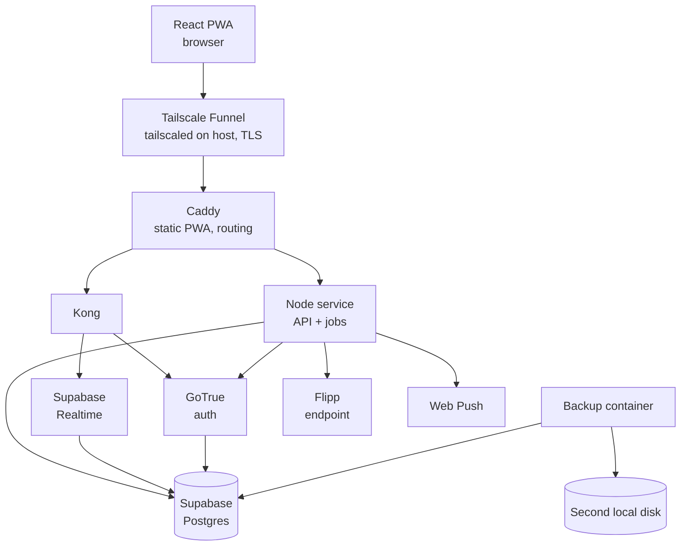

# Hearth — Technical Architecture

2026-09-17 · @Someone

Self-hosted Supabase and a Node service on an old desktop, published through Tailscale Funnel and Caddy. Every read and write goes through the service; auth and realtime go through Kong to Supabase.

## Topology



### Request paths

| Path | Route | Why |
| --- | --- | --- |
| Reads and writes (all) | PWA → Funnel → Caddy → Node service → Postgres | One place for validation, business rules, and job triggering; the service owns the API contract |
| Realtime subscriptions | PWA → Funnel → Caddy → Kong → Supabase Realtime | Direct, because proxying WebSockets through the service adds a layer with no benefit |
| Auth (sign-in, token refresh, sign-out) | PWA → Funnel → Caddy → Kong → GoTrue | Standard Supabase auth flow |
| Signup, password and email change | PWA → Funnel → Caddy → service → GoTrue (`http://auth:9999` on the Compose network) | The service applies the common-password check and password re-entry before GoTrue sees the request. Caddy refuses these GoTrue endpoints from outside (see Routing). |
| Deal fetching | Node service → Flipp | Server-side only; the browser never calls Flipp |
| Deal images | Browser → Flipp image CDN | Loaded directly and cached by the service worker; allowed by the CSP's `img-src` |
| Push sends | Node service → push endpoints | Requires the VAPID private key, which stays server-side |

### The RLS rule

**Every user-initiated request runs in Postgres as that user.** This is the single most important architectural constraint in this document. Using the service role for a user request would bypass row-level security entirely and move all authorization into application code, discarding the database-level isolation the design depends on.

The service verifies the caller's Supabase JWT (signature and expiry, with the GoTrue JWT secret). It then runs the request's database work through one wrapper, `withUserDb(jwt, fn)`. The wrapper takes a connection from the pool and opens a transaction that begins with:

```sql
set local role authenticated;
select set_config('request.jwt.claims', $1, true);  -- the verified claims as JSON
```

Inside that transaction `auth.uid()` returns the caller and every RLS policy applies. `fn` receives a Kysely instance bound to the transaction. The transaction commits when `fn` resolves and rolls back when it throws. Because both settings are transaction-local, nothing leaks to the next request that reuses the connection. There is no other way for a request handler to reach the database.

The service connects as a dedicated login role, `hearth_service`. It is granted membership in `authenticated`, `anon`, and `service_role`, so it can switch into each one; it has no other privileges. It is `NOINHERIT`, so until a transaction switches role it holds none of those roles' rights either, and a query that forgets to switch fails. The role and its memberships come from the first migration (`supabase/migrations/20260919060000_hearth_service_role.sql`), which creates it `NOLOGIN` with no password; see Secrets for how it gets its login.

The service role is used in exactly five places, none of which acts on behalf of a user's data request:

- scheduled jobs that legitimately operate across households (deal refresh, repricing, autopay logging, notification dispatch, pruning)
- migrations
- the owner CLI (`hearth-admin`)
- the GoTrue admin API call that changes a user's email, made only after the service has re-verified that user's password
- `public.system_health()`, called only by `GET /api/health/deep` after the caller has been checked as the server owner (see Database); its figures span every household, so it is `service_role`-only

In the service, the code that can reach either capability lives in `apps/service/src/privileged/`, which only `main.ts` and the CLI may import; routes receive the one narrow function they need (`changeEmail`, `systemHealth`) and nothing more. An ESLint rule enforces the import restriction, so a new route cannot quietly acquire the service role.

### Why everything routes through the service

Several rules cannot be expressed in RLS alone: derived recurrence and rotation, deal price normalization, repricing, readiness precomputation, notification batching, and reassign-and-depart. Centralizing reads and writes keeps those rules in one place and testable. There is no PostgREST: the service is the only HTTP path to the data.

Realtime subscriptions remain direct because they are reads governed by the same RLS policies, and Supabase Realtime already respects them.

### Membership lifecycle functions

Operations that must touch rows a member cannot write directly — other members' `household_member` rows, the `role` column, and the deletion of a whole household — are implemented as Postgres functions. The service calls them inside `withUserDb`. Each function is declared `security definer` with `set search_path = ''`, uses fully schema-qualified names, and checks the caller explicitly with `auth.uid()` before doing anything.

| Function | Caller check | Effect |
| --- | --- | --- |
| `public.create_household(name, postal_code, timezone)` | Caller is authenticated | Inserts the household and the caller's admin membership, and sets the caller's `profile.active_household_id` to it. `POST /api/households` calls this. |
| `public.departure_preview(household_id, user_id)` | Caller is that user, or is admin | Returns the items to reassign: lists created, chores assigned, open errands assigned, and unarchived household bills owned by the departing member. It also returns, for information only, each rotation the member is in and the member who will hold the turn after the removal, and, for the last member, the counts of what deleting the household would lose. |
| `public.depart_household(household_id, user_id, reassignments jsonb, confirm_name text)` | Caller is that user (leave), or is admin (remove) | In one transaction: apply every reassignment (and fail if any list, chore, errand, or bill is left unassigned), remove the member from rotation orders and rebase `rotation_offset`, delete the membership row, auto-promote the longest-tenured remaining member if the departing member was admin, delete the departed member's unsent notifications about the household, and delete the household and all its data if no member remains. The last case requires `confirm_name` to equal the household name. It then moves the departed user's `active_household_id` to their longest-held remaining membership, or null. |
| `public.transfer_admin(household_id, new_admin_id)` | Caller is admin; target is a member | Swaps the two roles |
| `public.redeem_invite(token_or_code text)` | Caller is authenticated | Hashes the input, finds a live invite by `token_hash` or `code_hash`, inserts the membership (a no-op if one already exists), and sets `profile.active_household_id` |
| `public.household_members(household_id)` | Caller is a member | Returns each member's user id, display name, role, and `joined_at`. `profile` is own-row only, so this is the only way to read a co-member's name, and it returns nothing else about them. `GET /households/:id/members` calls this. |
| `public.mark_household_active(household_id)` | Caller is a member | Sets `household.last_active_at` to now if it is not already in the current UTC day. Members cannot update `household` directly, so the request-level activity stamp goes through this. |

`reassignments` is a JSON object mapping the id of each owned list, chore, errand, and bill to a remaining member's id; rotation positions are never part of it. A key the member does not own, or a value that is not a remaining member, fails the call.

Invite credentials are stored as SHA-256 digests in lowercase hex. The service generates the link token as 32 random bytes, base64url-encoded, and the code as 8 random Crockford Base32 characters; the admin inserts the invite row with both digests. The shareable link is `<HEARTH_ORIGIN>/join#token=<token>`: the token rides in the fragment, which browsers never send to a server, so it stays out of every log between the invitee and the PWA. The link and the code are returned once, by the creating request, with `Cache-Control: no-store`; afterwards only the digests exist. `GET /households/:id/invites` lists the outstanding ones — neither revoked nor expired. `redeem_invite` hashes its input as given to match `token_hash`, and to match `code_hash` it first decodes the input the Crockford way: case, spaces, and hyphens are ignored, I and L read as 1, O reads as 0, and anything that is not then 8 alphabet characters (U included) is not a code. An invite is live while `revoked_at` is null and `expires_at` is in the future.

The functions report failures with SQLSTATEs the service maps to problem details:

| SQLSTATE | Meaning | Response |
| --- | --- | --- |
| `42501` | the caller fails the function's check, or an RLS policy refuses the write | `403` |
| `P0002` | the named user is not a member | `404` |
| `22023` | an invalid argument; the function's own message is shown | `400` |
| `HR001` | the invite is expired or revoked | `410` |
| `HR002` | no invite matches the link or code | `404` |
| `HR003` | the departure leaves something unassigned | `409` |
| `HR004` | the typed household name does not match | `400` |

Constraint violations map alongside them: `23505` and `23503` to `409`, `23502`, `23514`, `22P02`, `22007`, and `22008` to `400`. Any other database error is a `500` with no detail, recorded in `app_error`.

A request that names a household the caller does not belong to answers `404`, not `403`: `mark_household_active` runs before the handler and raises `42501`, which that path turns into "Household not found" so the API never reveals whether a household exists. `403` is reserved for a member who is not the admin. Deleting a household relies on `ON DELETE CASCADE` from `household` to every household-scoped table. `bill` cascades only household bills, because personal bills have a null `household_id`.

## Deployment

The target hardware is a repurposed desktop or laptop running Linux. Ubuntu Server LTS is assumed; any Docker-capable distribution works. It needs a second physical disk for backups.

### Hardware sizing

| Resource | Minimum | Comfortable |
| --- | --- | --- |
| CPU | 2 cores | 4 cores |
| RAM | 8 GB | 16 GB |
| Disk | 60 GB SSD, plus a second local disk for backups | 120 GB SSD, plus a second local disk for backups |

A laptop should have sleep-on-lid-close disabled and, if practical, be left plugged in. Its battery is a serviceable UPS.

### Compose layout

A single `docker-compose.yml`. It includes the subset of Supabase's official self-hosting stack that Hearth uses, plus Hearth's own services:

| Service | Role | Restart policy |
| --- | --- | --- |
| `db` | Supabase Postgres image, pinned | `unless-stopped` |
| `auth` | GoTrue | `unless-stopped` |
| `realtime` | Supabase Realtime | `unless-stopped` |
| `kong` | API gateway for `auth` and `realtime`. Its declarative config has no `rest`, `storage`, `functions`, or `analytics` routes. | `unless-stopped` |
| `hearth-service` | The Node API, job runner, and `hearth-admin` CLI | `unless-stopped` |
| `caddy` | Static PWA serving, routing, security headers | `unless-stopped` |
| `backup` | `prodrigestivill/postgres-backup-local`, nightly `pg_dump` | `unless-stopped` |

The production stack runs none of these: PostgREST, Storage, imgproxy, analytics/Logflare, vector, edge functions, or Studio. Studio is used only in local development, where the Supabase CLI provides it.

The file is `docker/docker-compose.yml`, with the Caddyfile, Kong config, Dockerfiles, and database init scripts beside it. Every image is pinned to an exact tag. `db`, `auth`, and `realtime` use the same images the pinned Supabase CLI runs for `supabase start`, so a production dump restores into local development unchanged. All services share one bridge network, `hearth`, with the fixed subnet `172.16.238.0/24` and gateway `172.16.238.1`, which the trusted-proxy settings below name. Only Caddy publishes a port. The database lives in the named volume `hearth_db-data`. `hearth-service` and `caddy` are built on the box as `hearth-service:<sha>` and `hearth-caddy:<sha>`; the Compose file runs whichever image is tagged `current`.

The PWA is built to static assets at deploy time and served by Caddy directly. There is no Node process serving the frontend.

### Ingress

`tailscaled` runs on the host OS, not in a container. Tailscale Funnel publishes `https://<machine>.<tailnet>.ts.net` on port 443 to the internet, terminates TLS with a certificate Tailscale provisions, and forwards to Caddy at `http://127.0.0.1:8080`:

```
tailscale funnel --bg http://127.0.0.1:8080
```

Caddy binds only `127.0.0.1:8080` and runs with `auto_https off`, over plain HTTP. Nothing else is published on the host. No port is forwarded on the router and no DNS record is needed.

**The machine name and tailnet name are pinned.** Both are recorded in the repo's README and in `.env` as `HEARTH_ORIGIN`, and must not change. The origin `https://<machine>.<tailnet>.ts.net` is baked into every installed PWA, its service worker registration, and every push subscription. Renaming either one changes the origin, which strands installed apps, orphans service workers, and invalidates every push subscription.

### Routing

One origin, path-based, all in the Caddyfile:

| Path | Upstream |
| --- | --- |
| `/api/*` | `hearth-service:3000` |
| `/auth/v1/*` | `kong:8000` |
| `/realtime/v1/*` | `kong:8000` (WebSocket upgrade) |
| `POST /auth/v1/signup*`, `PUT /auth/v1/user*` | Refused with `403`, before any proxying. The Caddy matcher is method-restricted and runs after path normalization (percent-decoding and collapsing duplicate slashes), so encoded or doubled-slash variants are refused too. |
| everything else | Static PWA build, with SPA fallback to `/index.html` |

The two refused endpoints can only be called by `hearth-service`, which reaches GoTrue directly on the Compose network. Blocking them at Caddy means nothing from outside can skip the common-password check at signup, or the password re-entry for password and email changes.

Caddy sets these headers on every response:

| Header | Value |
| --- | --- |
| `Content-Security-Policy` | `default-src 'self'; script-src 'self'; style-src 'self' 'unsafe-inline'; img-src 'self' data: https://f.wishabi.net https://images.wishabi.net; connect-src 'self' wss://<machine>.<tailnet>.ts.net; worker-src 'self'; manifest-src 'self'; object-src 'none'; base-uri 'self'; form-action 'self'; frame-ancestors 'none'` |
| `Strict-Transport-Security` | `max-age=31536000` |
| `X-Content-Type-Options` | `nosniff` |
| `Referrer-Policy` | `same-origin` |
| `Permissions-Policy` | `camera=(), microphone=(), geolocation=()` |

`style-src 'unsafe-inline'` is needed for the inline `style` attributes that Radix sets. `f.wishabi.net` serves Flipp item and flyer images and `images.wishabi.net` serves merchant logos; no wildcard beyond those hosts is allowed. `flipp-image-retrieval.flipp.com` is deliberately excluded because it only serves e-commerce items, with signed, expiring URLs, which the Flipp wrapper ignores.

### Client IP passthrough

Per-IP rate limits only work if the real client IP survives every hop: Funnel → Caddy → Kong → GoTrue, and Funnel → Caddy → service. If it is lost, every request appears to come from 127.0.0.1 or a container address, and each per-IP limit collapses into one global limit.

- Caddy: `trusted_proxies static 127.0.0.1/32 ::1/128 172.16.238.1/32`, `trusted_proxies_strict`, and `client_ip_headers X-Forwarded-For`, so it treats Funnel's forwarded address as the client IP. Funnel connects to `127.0.0.1:8080` on the host, but Docker's port publishing delivers that connection to Caddy from the Compose network's gateway, `172.16.238.1`, so the gateway is the hop Caddy must trust; the loopback entries only matter if Caddy runs on the host network. Strict mode takes the right-most untrusted address, so a client cannot choose its IP by sending its own `X-Forwarded-For`. When proxying, Caddy replaces `X-Forwarded-For` with that single address.
- Kong: `trusted_ips` set to the Compose network's subnet, `172.16.238.0/24`, with `real_ip_header X-Forwarded-For` and `real_ip_recursive on`.
- GoTrue: `GOTRUE_RATE_LIMIT_HEADER=X-Forwarded-For`.
- Fastify: `trustProxy` set to the Compose network's subnet, read from `HEARTH_TRUSTED_PROXIES` (comma-separated addresses or CIDRs; unset trusts no proxy). The Compose file sets it to `172.16.238.0/24`.

Verified locally in Phase 0 (2026-09-19): requests to `127.0.0.1:8080` carrying `X-Forwarded-For: 203.0.113.7` and then `198.51.100.9` appeared with those addresses as the request IP in the service's logs and as `remote_addr` in GoTrue's logs (a failed password grant), and a client-supplied address in front of the forwarded one did not change the result. Whether Funnel itself sets `X-Forwarded-For` can only be checked once the owner enables Funnel. The check: from two different outside networks (for example home Wi-Fi and a phone on cellular), open `https://<machine>.<tailnet>.ts.net/api/health` and attempt a sign-in with a wrong password, then confirm each network's public IP appears in `docker compose logs hearth-service` (`remoteAddress`) and `docker compose logs auth` (`remote_addr`). If Funnel does not forward the client address, that is recorded here as a known limitation before Phase 1 begins.

### Secrets

A single `.env` file on the host, never committed. Contents:

- the Postgres password and the `hearth_service` role password
- the GoTrue JWT secret, and the anon and service-role keys
- the VAPID key pair
- `HEARTH_ORIGIN`
- `HEARTH_OWNER_EMAIL`
- `HEARTH_MAGIC_LINK_ENABLED` (default `false`)
- `BACKUP_DIR`, the path of the backup directory on the second disk
- Realtime's `REALTIME_SECRET_KEY_BASE` and `REALTIME_DB_ENC_KEY`

A `.env.example` with placeholder values is committed for reference. `scripts/generate-secrets.sh` writes a fresh `.env` from it with every secret generated, and refuses to overwrite an existing one. The file lives at `/srv/hearth/.env`, outside the repository checkout, because the deploy runner wipes its checkout on every run; `scripts/deploy.sh` reads it from there (`HEARTH_ENV_FILE` overrides the path).

The `hearth_service` password never enters a migration. `docker/db/hearth-service-login.sql` runs `alter role hearth_service with login password …` from `HEARTH_SERVICE_DB_PASSWORD`, which the Compose file passes into the `db` container. It runs when the database is first initialized, right after the role migration, and again on every deploy after migrations, so it is idempotent and also applies a rotated password.

### Environments

Local development uses the Supabase CLI (`supabase start`), which runs Postgres, GoTrue, Realtime, Kong, and Studio locally, with the service and Vite dev server running against it on the host. CI's integration and E2E jobs use the same `supabase start` stack. There is no staging environment; the cost of one is not justified at this scale, so migrations are tested locally against a restored copy of a production backup.

## Auth configuration

Behaviour is specified in the Requirements document. This section gives the configuration.

| Setting | Value |
| --- | --- |
| `GOTRUE_MAILER_AUTOCONFIRM` | `true` — no verification email is ever sent |
| `GOTRUE_PASSWORD_MIN_LENGTH` | `8` |
| `GOTRUE_DISABLE_SIGNUP` | `false` — signup is open |
| `GOTRUE_MAILER_OTP_LENGTH` | `6` (used only when magic link is enabled) |
| `GOTRUE_SMTP_*` | Unset while magic link is disabled |
| Rate limits | GoTrue's built-in per-IP auth limits at their defaults, keyed on `X-Forwarded-For` |

- **Signup** goes through `POST /api/signup`. The service validates the email and the password (the common-password list from `packages/shared`), then calls GoTrue's `/signup` endpoint at `http://auth:9999`, passing `display_name` and the browser's `timezone` as `user_metadata` and the client's `X-Forwarded-For`. The `auth.users` trigger copies both into `profile`. The service returns GoTrue's session unchanged. Sign-in, token refresh, and sign-out go directly to GoTrue through Kong.
- **Password change** (`POST /api/users/me/password`). The service first re-verifies the current password against GoTrue's password grant. It then applies the common-password check and calls GoTrue's `PUT /user` at `http://auth:9999` with the caller's own JWT. Re-verifying the current password is skipped only when the session's `amr` claim shows a recovery sign-in, which is how the reset link lands. The pinned GoTrue records a verified recovery link as `amr` method `otp` rather than `recovery`, so both are accepted, and only within an hour of that sign-in (`GOTRUE_MAILER_OTP_EXP`, the link's own lifetime), so a session left open does not waive the check forever. When magic link is enabled, its sign-in carries the same `otp` method and waives the check in the same way: both prove control of the mailbox.
- **Email change** (`POST /api/users/me/email`). The service re-verifies the current password, then calls the GoTrue admin API (`PUT /admin/users/:id` with `email_confirm: true`) using the service-role key. No mail is sent. The `profile` trigger syncs the new email.
- **Password reset:** `docker compose exec hearth-service hearth-admin reset-password <email>` calls GoTrue's admin `generate_link` with type `recovery` and prints the resulting one-time link. The link expires after GoTrue's `GOTRUE_MAILER_OTP_EXP` (3600 seconds). Its `redirect_to` is `<HEARTH_ORIGIN>/set-password`, the PWA's set-new-password screen, which GoTrue's `/verify` reaches with the session in the URL fragment. The CLI is a bin in the service image, on the container's `PATH`.
- **Magic link:** when `HEARTH_MAGIC_LINK_ENABLED` is `false`, the PWA build omits the magic-link and code-entry screens. The Compose file passes the flag to the `caddy` image build, which exposes it to Vite as `VITE_MAGIC_LINK_ENABLED` (Vite only exposes `VITE_`-prefixed variables), so the screens are decided at build time and no flag reaches the browser at runtime. See the appendix for enabling it.
- **The PWA's client:** supabase-js is created against the app's own origin, so Caddy routes its calls on to Kong. Kong requires an `apikey` on `/auth/v1`, so the anon key is baked into the build the same way the magic-link flag is: the Compose file passes `ANON_KEY` to the `caddy` image build, which exposes it as `VITE_SUPABASE_ANON_KEY`. The anon key is the public half of the pair and grants nothing on its own — RLS and the service decide what a caller may do — so it is the one value that legitimately ships to the browser.
- **Sessions:** supabase-js default storage for the access and refresh tokens, protected by the CSP above.
- **Token verification:** the service verifies the access token's signature and expiry itself, and also refuses a token whose `role` is not `authenticated` — the anon and service-role keys are JWTs signed with the same secret. The production GoTrue signs with HS256 and `JWT_SECRET`. The pinned Supabase CLI signs local sessions with ES256 instead and publishes the public key at GoTrue's `/.well-known/jwks.json`, so ES256 is accepted when the token's `kid` names a key GoTrue publishes, fetched from GoTrue and cached (an unknown `kid` refetches at most once a minute). No other algorithm is accepted.

## The Node service

TypeScript on Node 24 LTS. Fastify for HTTP, Kysely for queries, no ORM. The service is the API layer, the job runner, and the `hearth-admin` CLI. At this scale, splitting them would add operational cost without benefit.

### API surface

REST under `/api`, resource-oriented, household-scoped by path where applicable. Paths below are relative to `/api`. Every route except those marked *public* requires a valid JWT.

| Group | Routes |
| --- | --- |
| Auth | `POST /signup` (*public*) |
| Users | `GET /users/me` (profile, `isServerOwner`, and the caller's memberships, each with its household's name, the caller's role, and the household's member count, which the switcher shows), `PATCH /users/me` (display name, timezone, quiet hours, household-bill reminders), `PUT /users/me/active-household`, `POST /users/me/password`, `POST /users/me/email` |
| Households | `GET /households` (the caller's memberships), `POST /households`, `GET /households/:id`, `PATCH /households/:id` (admin: name, postal code, timezone), `GET /households/:id/members`, `POST /households/join` (token or code) |
| Invites (admin) | `GET /households/:id/invites`, `POST /households/:id/invites` (returns the link and code once), `DELETE /households/:id/invites/:inviteId` (revoke) |
| Membership | `GET /households/:id/members/:userId/departure-preview`, `POST /households/:id/leave` (reassign-and-depart for the caller), `POST /households/:id/members/:userId/remove` (admin: reassign-and-depart for another member), `POST /households/:id/transfer-admin` |
| Favorite stores | `GET/POST /households/:id/favorite-stores`, `DELETE /households/:id/favorite-stores/:storeId` |
| Deals | `GET /households/:id/deals/search`, `GET /households/:id/flyers`, `GET /households/:id/flyers/:flyerId/items`, `GET /households/:id/merchants` |
| Lists | `GET/POST /households/:id/lists` (`?archived=true` for archived lists), `GET/PATCH/DELETE /lists/:id`, `POST /lists/:id/archive`, `POST /lists/:id/unarchive`, `POST /lists/:id/items`, `PATCH/DELETE /lists/:id/items/:itemId`, `POST /lists/:id/add-bought-to-pantry` |
| Pantry | `GET/POST /households/:id/pantry`, `PATCH/DELETE /pantry/:id` |
| Recipes | `GET/POST /households/:id/recipes`, `GET/PATCH/DELETE /recipes/:id`, `POST /households/:id/recipes/parse`, `POST /recipes/:id/add-to-list`, `GET /households/:id/suggestions` |
| Match overrides | `POST /households/:id/match-overrides`, `DELETE /match-overrides/:id` (the overrides that apply to a recipe come back in `GET /recipes/:id`) |
| Meal plan | `GET /households/:id/meal-plan?week=YYYY-MM-DD` (the week's Sunday; `week` is optional and defaults to the current week's Sunday in the household's own timezone when omitted, and a `week` value that is not actually a Sunday is rejected with `400`), `POST /households/:id/meal-plan`, `DELETE /meal-plan/:id`, `POST /meal-plan/:id/add-to-list`, `POST /households/:id/meal-plan/add-to-list` (a whole week) |
| Bills | `GET/POST /households/:id/bills` (GET includes the caller's personal bills), `POST /users/me/bills` (create personal), `GET /households/:id/subscriptions`, `GET/PATCH/DELETE /bills/:id`, `POST /bills/:id/pay`, `POST /bills/:id/skip`, `POST /bills/:id/archive`, `POST /bills/:id/confirm-usage`, `PATCH/DELETE /bills/:id/payments/:paymentId` |
| Chores | `GET/POST /households/:id/chores`, `GET/PATCH/DELETE /chores/:id` (GET includes completion history), `POST /chores/:id/complete`, `DELETE /chores/:id/completions/:completionId` (only the most recent completion; otherwise `409`. In the same transaction it deletes any unsent `chore_rotation` outbox row for that occurrence. A push already sent stays sent.) |
| Errands | `GET/POST /households/:id/errands`, `GET/PATCH/DELETE /errands/:id` (PATCH sets `status` absolutely; `done` stamps `completed_at` and `completed_by`) |
| Notifications | `GET/PATCH /users/me/notification-preferences`, `POST /users/me/push-subscriptions`, `DELETE /users/me/push-subscriptions` (body: endpoint) |
| System | `POST /client-error` (*public*, rate-limited), `GET /health` (*public*), `GET /health/deep` (server owner only) |

Offline-queueable writes (`POST /lists/:id/items`, `PATCH /lists/:id/items/:itemId`, `POST /chores/:id/complete`, `PATCH /errands/:id`) accept a client-generated UUID where they create a row. They are idempotent, as specified under Offline behavior in the Requirements document.

`POST /lists/:id/items` takes either a manual item — its name, and optionally a quantity, a hand-entered price and unit, and a store — or a deal's id. It never takes a price for a deal: the service reads the `deal` row and copies the snapshot itself, so a client cannot invent one, and the item's `normalized_name` is the deal's own, which is the key repricing re-matches on. A manual item's `normalized_name` is computed from its name by `@hearth/matching`.

`GET /lists/:id` answers with the list's items already grouped by store, each group carrying its subtotal and its count of unpriced items, and the bought items in a group of their own. The client never does money arithmetic; every amount in a list, pantry, or deal response is an integer number of cents, named with a `Cents` suffix.

### Conventions

- Every request carries the caller's Supabase JWT as a bearer token. Handlers reach the database only through `withUserDb`.
- Request and response shapes are Zod schemas in `packages/shared`. The service validates with them, and an OpenAPI 3.1 document is generated from them at build time and served at `/api/openapi.json`.
- Errors return RFC 9457 problem details (`type`, `title`, `status`, `detail`) — never a bare string
- Responses are camelCase; the database is snake\_case; mapping happens in one layer
- No endpoint returns another household's data. The only responses that span households are the caller's membership list and the caller's own personal bills.
- A request that names a household updates `household.last_active_at` if it has not already been updated that UTC day, through `public.mark_household_active`.
- `isServerOwner` is true when the JWT's email equals `HEARTH_OWNER_EMAIL`, compared case-insensitively.

#### Deals responses

The four deals reads answer with the data plus the freshness the UI needs to pick its state (Design › Deals-specific states):

| Field | Meaning |
| --- | --- |
| `asOf` | When the data being returned was fetched; null when nothing has ever been fetched |
| `stale` | A live fetch failed, or the cache is past its TTL and could not be replaced, so what is shown is older than `asOf` implies is current |
| `refreshing` | A background refresh for this postal code is queued, so the PWA refetches |

`deals/search` and `flyers/:flyerId/items` add `page`, `pageSize` (50), `total`, and `hasMore`. A deal carries every field the `DealCard` needs, including `displayPrice`, `conditionalPrice` with its `conditionalReason`, `discountPercent`, and `validFrom`/`validTo`; prices are integer cents.

`deals/search` takes `q` (required), `scope` (`favorites`, the default, or `all`), `stores` (comma-separated merchant ids), `category`, `minPrice` and `maxPrice` in cents, `sort` (`relevance`, the default, or `price`), and `page`. `flyers` takes `scope`; `flyers/:flyerId/items` takes `category`, `sort`, and `page`. A household with no favorites yet is shown every merchant rather than nothing, since the screen's job then is to prompt for favorites with browse-all already working.

A failed fetch with nothing cached answers `503`, which is the error-with-retry state; with anything cached it answers `200` and `stale: true`, because stale data beats empty data (non-negotiable 18).

`DELETE /households/:id/favorite-stores/:storeId` takes the **merchant id**, not the row id, because that is what the merchant list and the flyer rows carry. `POST` on an existing favorite updates its name rather than failing, so a replayed add changes nothing.

### Rate limits

`@fastify/rate-limit`, keyed on the client IP (see Client IP passthrough), with in-memory storage:

| Scope | Limit |
| --- | --- |
| All of `/api/*` | 300 requests per minute per IP (`HEARTH_RATE_LIMIT_PER_MINUTE`) |
| `POST /api/client-error` | 10 requests per minute per IP |

`HEARTH_RATE_LIMIT_PER_MINUTE` is a positive integer, default `300`, read by `hearth-service` at startup; a value that is not one fails startup. Production never sets it. The E2E Compose overlay sets `3000`, because every loopback request shares one client address and a full suite run would otherwise exhaust the bucket. The limiter is never disabled in any environment.

A request over the limit gets `429` with a problem-details body and a `Retry-After` header.

### Scheduled jobs

`node-cron` in-process. Schedules are in UTC; anything user-facing resolves against the household or user timezone as the Requirements document specifies.

| Job | Schedule | Purpose |
| --- | --- | --- |
| `refresh-deals` | Daily 08:00 UTC | Refresh deals for every active postal code, then reprice expired list items, recompute readiness for affected households, and enqueue `flyer_refresh` rows |
| `log-autopay` | Every 2 minutes | Log automatic payments for autopay occurrences whose due date has begun |
| `dispatch-notifications` | Every 2 minutes | Enqueue scheduled reminders whose send time has arrived into the `notification` outbox, then send due rows |
| `prune-cache` | Daily 04:00 UTC | Delete `deal` rows past `valid_to`, `deal_query_cache` rows past their TTL, sent `notification` rows older than 90 days, and `app_error` rows whose `last_seen` is older than 90 days |

**Autopay logging** is the `log-autopay` job. It runs every 2 minutes, so a day's automatic payment is logged well before that day's 09:00 reminder. The due date is evaluated in the bill's own timezone: the household's for a household bill, the owner's for a personal bill. For each non-archived autopay bill, the job inserts a `bill_payment_log` row for every occurrence that has no log row yet, is dated on or before today, and is dated on or after the bill's `created_at` date. It never backfills occurrences from before the bill existed; those follow the normal unpaid and overdue rule. Each row has `paid_date` equal to the occurrence date, `amount_paid` equal to `bill.amount`, `is_auto` true, and `recorded_by` null. The insert uses `on conflict (bill_id, occurrence_date) do nothing`.

**Dispatch.** Each run does two things.

1. **Enqueue.** For every scheduled type and every recipient whose send time for today has passed in the relevant timezone, the job inserts an outbox row with `on conflict do nothing` on (`user_id`, `type`, `target_id`, `occurrence_key`). Only today's send times are enqueued, so downtime never produces a backlog of stale reminders. Preferences are checked at enqueue time, and so are the conditions: still unpaid, still uncompleted, still unplanned. `list_activity` and `chore_rotation` rows are enqueued by the request that causes them, and `flyer_refresh` rows by `refresh-deals`, not by this step.
2. **Send.** It selects rows with `sent_at is null and send_after <= now()`, sends each to every one of the recipient's push subscriptions, and stamps `sent_at`.

`send_after` is set when a row is written. If it falls inside the recipient's quiet hours, it is moved to the end of the window. Both calculations are SQL functions, `public.next_local_time(after, tz, at_local)` and `public.after_quiet_hours(send_at, tz, quiet_start, quiet_end)`, so every writer of an outbox row — jobs as `service_role`, and the request-written `list_activity` and `chore_rotation` rows as `authenticated` — gets the same answer, resolved in the timezone that owns the time rather than the server's.

### Idempotency

Jobs must be safe to run twice — a restart mid-run must not double-send or double-log.

- Each job takes `pg_try_advisory_lock(hashtext('<job name>'))` on a dedicated connection and skips the run if the lock is held.
- Notification idempotency comes from the outbox's unique key. An enqueue that repeats is a no-op, and `sent_at` is stamped once per row.
- Deal refresh writes are upserts on (`postal_code`, `external_id`). `log-autopay` relies on the unique (`bill_id`, `occurrence_date`) key. Repricing and readiness recomputation are deterministic from current data.
- Recurrence is derived on read, so there is nothing to advance and nothing to double-advance.

### Failure handling

- A failed deal fetch for one postal code does not abort the job for others; each is caught independently
- Push sends returning 404 or 410 delete the stored subscription — the browser has revoked it
- Any unhandled job or request error is logged and recorded in `app_error` (see Observability)

## Recipe fetching

The service fetches user-pasted recipe URLs and extracts schema.org JSON-LD, falling back to an editable manual form when a page has no usable markup.

- Fetches are user-initiated and low volume; no crawling, no link following, no bulk import
- A descriptive `User-Agent` identifying the app and the origin `HEARTH_ORIGIN`, as basic hygiene toward sites the feature depends on
- Outbound fetches are limited to 1 request per second per host, a 10-second timeout, and a 5 MB response body. A slow or enormous page cannot tie up the service.
- Only `http` and `https` schemes; requests to private address ranges are refused, which prevents a pasted URL being used to probe the local network
- Each `recipeIngredient` line is split by the ingredient-line parser library into quantity, unit, and item name, keeping the original line as `raw_text`. The split is returned in the editable preview and saved only when the user confirms.
- `POST /households/:id/recipes/parse`'s response carries a `needsManualEntry` boolean: true only when the page had no JSON-LD `Recipe` node at all, never on a merely incomplete one (say, ingredients but no instructions), which still comes back with the gaps left null for the same editable preview to fill in.
- `PATCH /recipes/:id` takes the same shape as the create body, every field optional: a given `ingredients` array replaces the recipe's ingredient list wholesale rather than merging one in, since the client always holds and re-sends the full edited set and a newly added line has no id yet to key a merge on.

## Flipp wrapper

One module, one file, isolated behind an interface. Everything that knows Flipp's response shape lives here so a breaking change upstream is a single-file fix. The endpoint URLs, parameters, and quirks are in Endpoints below.

### Contract

```typescript
interface DealSource {
  searchItems(postalCode: string, query: string): Promise<NormalizedDeal[]>;
  listFlyers(postalCode: string): Promise<Flyer[]>;
  listFlyerItems(flyerId: string): Promise<NormalizedDeal[]>;
  listMerchants(postalCode: string): Promise<Merchant[]>;
}

interface NormalizedDeal {
  externalId: string;
  name: string;
  merchantId: string;
  merchantName: string;
  unitPrice: number;          // integer cents, rounded half-up
  priceUnit: 'each' | 'lb' | 'oz';
  originalPrice: number | null;    // integer cents
  discountPercent: number | null;  // integer, floored
  displayPrice: string;       // original copy, e.g. "2/$6.00"
  conditionalPrice: boolean;
  conditionalReason: 'coupon' | 'loyalty_card' | null;
  category: string | null;
  flyerId: string;
  validFrom: string;          // ISO date, in the store's local offset
  validTo: string;
  imageUrl: string | null;
  sourceUrl: string | null;
}

interface Flyer {
  flyerId: string;
  merchantId: string;
  merchantName: string;
  validFrom: string;
  validTo: string;
  thumbnailUrl: string | null;
  logoUrl: string | null;
}

interface Merchant {
  merchantId: string;
  name: string;
  logoUrl: string | null;
}
```

Prices cross this boundary as integer cents, like every other amount in the codebase; the `numeric(10,2)` columns are dollars, and the one layer that maps camelCase to the database converts them. Alongside `DealSource`, the wrapper exposes its per-merchant skip counts and a reset, which the refresh job hands to System health and nothing else reads.

The rest of the service depends only on `DealSource`, never on Flipp's raw shapes. A test double implementing the same interface is what the unit tests use.

### Endpoints

Base URL `https://backflipp.wishabi.com`. Every call is an unauthenticated `GET` returning JSON; no key, cookie, token, or `Referer` is needed. The module's header comment carries this same table.

| Mode | Path | Parameters | Fields the wrapper reads |
| --- | --- | --- | --- |
| search | `/flipp/items/search` | `postal_code`, `q` (required); `locale=en-us` | `items[]` with `item_type` `flyer` (`ecom_items` and every other key are ignored): `id`, `flyer_id`, `name`, `merchant_id`, `merchant_name`, `merchant_logo`, `current_price`, `original_price`, `pre_price_text`, `post_price_text`, `sale_story`, `_L1`, `_L2`, `clean_image_url`, `valid_from`, `valid_to` |
| flyers | `/flipp/flyers` | `postal_code` (required); `locale=en-us` | `flyers[]`: `id`, `merchant_id`, `merchant`, `merchant_logo`, `valid_from`, `valid_to`, `thumbnail_url` |
| flyer items | `/flipp/flyers/{flyerId}` | `locale=en-us` | `items[]`: `id`, `name`, `display_type`, `price`; `pages[]` is ignored |
| item detail | `/flipp/items/{itemId}` | none | `item`: `name`, `merchant`, `merchant_id`, `pre_price_text`, `current_price`, `price_text`, `original_price`, `sale_story`, `image_url`, `ttm_url`, `valid_from`, `valid_to` |
| merchants | `/flipp/merchants` | `locale=en-us` | `merchants[]`: `id`, `name`, `us_based` |

Item detail is not a `DealSource` mode; it is how `listFlyerItems` prices a flyer. `flyers-ng.flippback.com` serves equivalent flyer and flyer-item data (`/api/flipp/data`, `/api/flipp/flyers/{id}/flyer_items`) with the same gaps; the wrapper does not use it. The quirks the wrapper absorbs, so nothing outside it sees them:

- **Search is capped at 150 items, with no pagination.** Page and offset parameters are ignored, and the true total appears only in `facets`. The 150 returned are the result.
- **Search and flyers include upcoming flyers.** The wrapper drops any flyer or item whose `valid_from` is after the current time; "active" means `valid_from` ≤ now ≤ `valid_to`.
- **The flyer-items listing cannot be priced on its own.** It has a bare `price` string and no pre- or post-price text, sale story, original price, merchant, or category, so `"6.0"` may really be "2/$6 with VIC card". `listFlyerItems` uses the listing only as a roster. For each product (`display_type` 1 or 25) with a non-empty `price`, it requests `/flipp/items/{id}` and normalizes from the detail. Products with an empty `price` count as skipped (no price). Banners (`display_type` 5) and navigation links (7) are ignored and not counted.
- **Merchants is a global directory.** It ignores `postal_code`, lists about 2,500 US and Canadian retailers, and has no logos. `listMerchants(postalCode)` returns the directory entries that have an active flyer in that postal code's flyers response, with the logo taken from the flyer's `merchant_logo`.
- **Prices are numbers in search** (`3.99`) **and strings elsewhere** (`"6.0"`, or `""` for none). Both become integer cents before the normalization chain runs.
- **Search timestamps are UTC** (`2026-09-23T03:59:59+00:00`); flyers, flyer items, and item detail use the store's local offset (`2026-09-22T23:59:59-04:00`). `validFrom` and `validTo` are calendar dates in the local offset, so a search item takes its dates from its flyer, matched by `flyer_id`, in the cached flyers response for the postal code. A search item whose flyer is not in that response is dropped.
- **Some image URLs are `http://`.** The wrapper rewrites them to `https://`, which the CSP requires.
- **Merchant names can carry trailing spaces** (`"Costco "`). The wrapper trims them.
- **`sourceUrl`** is item detail's `ttm_url`, which is often null. Search has no source URL, so `sourceUrl` is null for search results.
- **`category`** is search's `_L2`, falling back to `_L1`. Flyer items have no category, so it is null for them, and an upsert never replaces an existing non-null `category` with null.
- **Item ids change every week; merchant ids are stable** (Harris Teeter is always 2431), which is why favorites are stored by merchant id.

### Price normalization

Implemented as an ordered chain of parsers, each attempting the raw price copy and passing on failure. The rules, including what is skipped and how values round, are in the Requirements document. The implementation obligations are:

- Every parser is a pure function with its own unit tests over recorded real-world strings
- A deal that no parser handles is **skipped**, not stored with a null price
- Skips are counted per fetch per merchant and logged. A merchant whose skip rate in a run is above 40% logs a warning, since that usually signals a format change rather than genuinely odd deals. The per-merchant counts from the most recent refresh are kept in memory for System health. They reset when the service restarts, so System health labels them "since last refresh" and shows none until a refresh has run.
- `displayPrice` always retains the original copy, so the UI can show "2 for $5" alongside the computed $2.50 unit price

### Caching and storage

Live calls with aggressive caching. The browser never calls Flipp; only the service does.

| Query | TTL | Where |
| --- | --- | --- |
| Flyers by postal code | 12 hours | In-process memory |
| Flyer items | Until the flyer's `valid_to`. Fetched once per flyer, and never re-fetched while `deal` rows for that `flyer_id` exist and the flyer is valid | `deal` rows, by `flyer_id` |
| Search by (postal code, query) | 6 hours | `deal_query_cache` (deal ids), with the deals themselves in `deal` |
| Merchant directory | 7 days | In-process memory, one copy for all postal codes, since the directory ignores postal code |

`deal` rows are upserted on (`postal_code`, `external_id`), with `normalized_name` computed by the `matching` package and `fetched_at` set to the time of the fetch. A cache miss triggers a live fetch. If a live fetch fails while a stale entry exists, the service returns the stale entry and its age, which the UI renders as an "as of" label.

### Daily refresh

`refresh-deals` builds the set of postal codes from households whose `last_active_at` is within 14 days. For each postal code:

1. It fetches the active flyers.
2. It fetches flyer items only for flyers whose merchant is in the union of `household_favorite_store` merchant ids across households at that postal code, and only once per flyer: a flyer is not re-fetched while `deal` rows for its `flyer_id` exist and it is valid. Fetching one flyer's items is its roster request plus one item-detail request per priced product (see Endpoints), all through the same serialized request queue, backoff, and circuit breaker as every other call.
3. It upserts each flyer's items into `deal` once all of that flyer's requests have finished. An item whose detail request still fails after backoff counts as skipped. A flyer cut short by the circuit breaker opening writes nothing, so the next run fetches it whole rather than leaving it partial.

Once every postal code has been through those steps, the run reprices expired list items (see Repricing) and recomputes `recipe_readiness` for every household it covered. Both are deterministic from current data, so they run once at the end of the run rather than inside the loop: a postal code whose fetch failed must not stop another household's items being corrected.

After a refresh, the job sets `postal_code_refresh.last_refreshed_at` for each postal code it refreshed.

A flyer counts as new when, before the run, no `deal` row had its `flyer_id`. No `flyer_refresh` is enqueued for a postal code that had no previous refresh, meaning `last_refreshed_at` was null, or it was dormant before this run. Both conditions are read from `last_refreshed_at`: a stamp that is null, or older than a day when the run started, is a postal code the last daily run did not cover. `last_active_at` cannot answer this, because `mark_household_active` has already stamped the caller's household before a queued on-demand refresh runs, and the first daily run after dormancy sees a postal code that is active again. Otherwise, for each household with a new flyer from a favorite merchant, the job enqueues a `flyer_refresh` row for each opted-in member, with `occurrence_key` set to that day's date, which limits it to once per day per household. `send_after` is the recipient's next 09:00 local time.

### Dormant postal codes

Dormancy governs only the flyer and flyer-item refresh. A keyword search that misses the cache always fetches live and synchronously, under the normal rate discipline, whether or not its postal code is dormant.

A postal code is dormant when no household with that postal code has a `last_active_at` within 14 days. A flyers or flyer-items request for a dormant postal code queues one background refresh for it. It does so only if `postal_code_refresh.last_on_demand_at` is not already in the current UTC day, and it sets that column when it queues, which makes the one-per-UTC-day limit hold whether or not any deal rows exist. The claim and the queueing are one statement — an upsert that writes `last_on_demand_at` only when it is not already in the current UTC day — so two concurrent requests queue one refresh between them.

The daily job reads `last_active_at` directly, because it runs as `service_role` and sees every household. **A request cannot, and reads `postal_code_refresh.last_refreshed_at` instead.** Two things stop it using `last_active_at`: RLS shows a caller only the households they belong to, so the maximum across a postal code is not readable, and `mark_household_active` has already stamped the caller's own household by the time the handler runs. `last_refreshed_at` answers the same question from the other side, because the daily run sets it for exactly the postal codes that are not dormant: one that is null, missing, or more than 24 hours old is one the last run did not cover. A run that failed for an active postal code therefore also reads as dormant, which costs at most one extra cache-miss fetch that day and is what the rate discipline already allows.

The refresh runs the same steps as a daily refresh for that single postal code. It goes through the same serialized request queue and is skipped while the circuit breaker is open. The request that triggered it returns immediately:

- with whatever is cached, marked stale with its "as of" age, and `refreshing: true`
- or, when no flyers are cached, an empty list with `refreshing: true`

The PWA refetches while `refreshing` is true. This counts as a cache-miss fetch, which the rate discipline allows. The refresh takes minutes rather than seconds, so the refetch backs off — three seconds, doubling to a minute — and stops after ten attempts, leaving whatever is cached on screen with its "as of" label and a manual retry rather than polling forever. It also stops while the browser is offline, since the request could only fail.

**A flyer-items request never fetches inline**, dormant or not. One flyer costs its roster request plus an item-detail request per priced product, roughly 120 to 300 requests over several minutes, which no screen may trigger and no request may wait for. It is served from the `deal` rows for that `flyer_id`, which are the flyer-item cache. When there are none and the postal code is dormant, the request queues the day's one background refresh and answers with the refreshing state. When there are none and the postal code is active, the answer is an ordinary empty list: the daily run covers the postal code, and a flyer whose merchant nobody there favorites legitimately has no items.

### Repricing

This runs after each refresh and when a list is fetched. It applies to `shopping_list_item` rows whose `deal_valid_to` has passed and whose status is not bought. Each item is looked up in `deal` by (`postal_code` of the household, `merchant_id`, `normalized_name`) among rows still valid, choosing the lowest `unit_price`. The Requirements document specifies the fallback order and what is recorded.

### Rate discipline

- Requests are serialized with a minimum 500ms gap; no parallel bursts
- A descriptive `User-Agent` identifying the app and its origin: `Hearth/1.0 (self-hosted household admin; +<HEARTH_ORIGIN>)`
- Exponential backoff on any non-200: three attempts a request, waiting one second and then two, each still behind the minimum gap. A circuit breaker opens after 5 consecutive failed requests and stays open for 30 minutes, refusing every call in that window without touching the network; the first call after it lapses is the one that closes it. A request that fails after its attempts are spent, or that finds the breaker open, throws, so a flyer part-way through its item-detail requests is abandoned rather than stored half-priced.
- The daily refresh runs once per **active postal code**, not once per household, so ten households in one ZIP cost one flyer fetch, and it fetches flyer items only for favorited merchants. A dormant postal code gets at most one on-demand refresh per UTC day, under the same rules.
- A favorited merchant's flyer costs its roster request plus one item-detail request per priced product, roughly 120 to 300 requests over a few minutes at the 500ms gap, once per flyer. It is never fetched again while `deal` rows for that `flyer_id` exist and the flyer is valid.
- No fetch is ever triggered directly by a user action that a cache could serve

### Development

Development uses live calls, respecting the same caching and rate rules. Tests never make live calls. They run against two kinds of fixtures, both checked into the repo:

- raw Flipp responses, first captured by the Phase 0 spike
- normalized `NormalizedDeal`, `Flyer`, and `Merchant` JSON, one file per captured response

Fixtures are refreshed deliberately, never automatically, so a fixture update is a visible diff that documents an upstream change. `pnpm fixtures:normalize` regenerates the normalized set by running the wrapper against the raw captures through a transport that reads them from disk, and a unit test fails when the committed files and that output differ.

Because the wrapper drops flyers that are not active now, the normalized fixtures are generated against a fixed clock: `refreshed_at` from `flyers-27514.json`, the instant the spike captured. Any other clock would expire or hide flyers the captured responses still refer to. At that instant four of the 62 captured flyers are upcoming — ALDI's, CVS Pharmacy's, Family Dollar's, and Walgreens' next weeks — leaving 58 active, which is what exercises the upcoming-flyer rule.

The captures record one item detail per merchant flyer, so a flyer-items run over a fixture is limited to a roster of the items whose detail exists, plus an empty-priced product and a banner for the rules that need them.

## Database

Postgres at the version shipped in the pinned Supabase image. The schema in the Requirements document is authoritative for tables and fields.

### Migrations

Supabase CLI migrations — plain SQL files, timestamped, applied in order, checked into the repo under `supabase/migrations/`.

- Every schema change is a migration; none are applied by hand against a running database
- Migrations are forward-only. A mistake is corrected by a new migration, not by editing an applied one.
- Each migration is tested locally against a restored production backup before deployment
- RLS policies and `security definer` functions live in migrations alongside the tables they protect, never configured through Studio
- Tables that the realtime layer streams (`shopping_list`, `shopping_list_item`, `chore_completion`, `errand`) are added to the `supabase_realtime` publication in a migration

### Realtime subscriptions

The PWA subscribes to Supabase Realtime directly (see Request paths), so RLS is the only thing between a stream and another household's data. Realtime evaluates each subscriber's policies as that user, with the claims from the access token the channel carries.

An open shopping list subscribes to one channel, `list:<listId>`, with two `postgres_changes` bindings:

| Binding | Schema and table | Filter |
| --- | --- | --- |
| Item changes | `public.shopping_list_item` | `list_id=eq.<listId>` |
| The list itself | `public.shopping_list` | `id=eq.<listId>` |

The second binding is not redundant. A delete on a filtered subscription carries only the row's primary key, because that is all the default replica identity puts in the WAL, so a filter on `list_id` cannot match it and Realtime does not deliver it. The list row's own update is what a member sees when another member deletes an item: the `updated_at` trigger fires on every insert, update, and delete of an item, and the client treats a change to the list row as the signal to refetch the list. That is also what keeps a subtotal correct after a change the client cannot reconstruct locally.

Channels are named after the resource, not the household, so switching household tears down exactly the subscriptions that belonged to the previous one.

### RLS policy pattern

Every household-scoped table follows the same shape. A helper keeps it consistent:

```sql
create function public.is_household_member(hid uuid)
returns boolean
language sql security definer stable
set search_path = ''
as $$
  select exists (
    select 1 from public.household_member
    where household_id = hid and user_id = auth.uid()
  );
$$;

alter table public.shopping_list enable row level security;

create policy household_read on public.shopping_list
  for select using (public.is_household_member(household_id));

create policy household_write on public.shopping_list
  for all using (public.is_household_member(household_id))
  with check (public.is_household_member(household_id));
```

Variants needed:

| Table group | Policy |
| --- | --- |
| Household-scoped tables | Membership in `household_id` |
| Child tables (`shopping_list_item`, `recipe_ingredient`, `chore_completion`, `bill_payment_log`) | Membership via the parent's `household_id`; for `bill_payment_log`, the parent bill's policy |
| `recipe_readiness` | Membership in `household_id`. The service rewrites rows inside the request that changed a pantry item, recipe, or override, and in `refresh-deals`; no route edits it directly. |
| `bill` | Membership when `visibility = 'household'`; `owner_user_id = auth.uid()` when personal |
| `profile`, `notification_preference`, `push_subscription` | `id` or `user_id = auth.uid()` only. A user updates only their own display name, timezone, active household (which must be one of their memberships), quiet hours, and household-bill setting; `email` follows `auth.users`. Co-members' names come from `household_members`, never from `profile`. |
| `notification` | Select own rows (`user_id = auth.uid()`). Select, insert, update, and delete only unsent `list_activity` and `chore_rotation` rows whose target list or chore belongs to a household that both the caller and the recipient are members of, which the request that causes them writes (the batching upsert reads the row it extends; undoing a completion deletes it). All other rows are written by the service role in jobs. A `chore_rotation` row's `send_after` is written as `now()`, not deferred into the recipient's quiet-hours window the way a job defers a scheduled type: the completing member's own request cannot read the recipient's `profile` row (quiet hours included) under this same RLS, by design (row above). Per-user quiet hours are Phase 5 scope regardless (Implementation Handoff, "Phase 5 — Cross-cutting"), so its `dispatch-notifications` job, which already reads `profile` as service_role, is what checks quiet hours for this type too, the same as for every other. |
| `household`, `household_member` | Select by membership. Inserts go only through `create_household` and `redeem_invite`, and deletes and role changes only through the other membership lifecycle functions. Direct updates to `household` name, postal code, and timezone require `role = 'admin'`. |
| `household_invite` | Select, insert, and update (revoke) only when the caller is the admin of `household_id`. The admin inserts only `household_id` and the two hashes; the other columns take their defaults, so an invite always starts now. The only updatable column is `revoked_at`, set once on an invite not yet revoked; there is no delete. Redemption goes through `redeem_invite`, never direct access. |
| `deal`, `deal_query_cache`, `postal_code_refresh` | Select, insert, and update where `postal_code` is the postal code of a household the caller belongs to. No delete; pruning is a job. |
| `app_error` | No direct access; written only through `public.record_app_error(fingerprint, message)`, a `security definer` function with `set search_path = ''`, granted to `anon` and `authenticated` |

Every table has RLS enabled. A table without a policy denies everything, which is the correct default — an unprotected table is a bug, not a convenience.

Privileges are granted explicitly too. The migrations revoke Supabase's default grants on `public` from `anon` and `authenticated`, and `EXECUTE` on new functions from `PUBLIC`. `authenticated` holds only the table and column privileges its policies need, and `EXECUTE` on the functions above; `anon` holds nothing but `EXECUTE` on `record_app_error`. The policy helpers besides `is_household_member` (`is_household_admin`, `is_member_postal_code`, `can_access_bill`, `can_write_member_notification`) are `security definer` with `set search_path = ''` in the same way.

System health reads its figures through `public.system_health()`, a `security definer` function with `set search_path = ''`. It returns only aggregates: the newest `deal.fetched_at`, the newest `notification.sent_at`, and the `app_error` rows seen in the last 24 hours. The service calls it only from `GET /api/health/deep`, after checking that the caller is the server owner, as `service_role`: its error messages span every household, so only `service_role` may execute it.

### Indexes

Beyond primary keys and the unique keys the Requirements document names:

- `household_member(user_id)` and `household_member(household_id)`
- every `household_id` foreign key
- `deal(postal_code, valid_to)`
- `deal(postal_code, merchant_id, normalized_name)`
- `bill_payment_log(bill_id, occurrence_date)`
- `chore_completion(chore_id, occurrence_date)`
- `notification(send_after) where sent_at is null`

Matching runs in the service, so no index exists to support it.

### Backups

Automated and scheduled, since this is the only copy of the data.

- The `backup` container (`prodrigestivill/postgres-backup-local`) runs `pg_dump` nightly at 02:00 UTC (`SCHEDULE="0 2 * * *"`), compressed. It writes to `BACKUP_DIR`, a directory on a **second local disk** mounted into the container.
- Retention: `BACKUP_KEEP_DAYS=14`, `BACKUP_KEEP_WEEKS=8`, `BACKUP_KEEP_MONTHS=6`, pruned by the container on the same schedule.
- There is no off-site or cloud copy. Fire, theft, and a whole-machine loss are accepted risks, in keeping with free hosting.
- **A backup is taken immediately before every deploy's migrations** (`docker compose exec backup /backup.sh`). If the backup fails, the deploy is aborted.
- `BACKUP_DIR` is also mounted read-only into `hearth-service`, so that System health can report the newest backup file's modification time.
- **Restores are tested quarterly.** An untested backup is an assumption. The restore procedure lives in the repo's README.
- `pg_dump` does not include roles. A restore therefore targets a fresh container of the same pinned Supabase Postgres image, which creates the Supabase roles (`anon`, `authenticated`, `service_role`, `supabase_auth_admin`, and the rest) at initialization. `hearth_service` is recreated from its migration. `supabase_realtime_admin` is created by Realtime rather than the image, so the restore procedure creates it before loading the dump. The dump restores the schemas, including `auth`, the data, the grants, the RLS policies, and the functions.
- The dump is taken as `supabase_admin` with `--clean --if-exists`, so loading it replaces the objects a fresh container already has, such as the initial `auth` tables.

## Observability

Self-hosted, like everything else. The goal is that the server owner can see what broke by opening System health, with nothing running beyond the app itself.

### Logging

**Pino** in the service, structured JSON to stdout, collected by Docker's `json-file` logging driver with `max-size: 10m` and `max-file: 5` on every service, so logs cannot fill the disk.

Every log line carries a request id or a job name. Levels: `error` for anything needing attention, `warn` for degraded-but-working (stale cache served, high skip rate), `info` for job start and finish with counts, `debug` off in production.

Particular things worth logging at `info`:

- deals fetched and skipped per merchant per run
- notifications sent per type per run
- autopay payments logged per run
- every Flipp request, as its mode and path with the gap since the previous one, so the rate discipline is readable rather than assumed (Handoff, Phase 2). A search URL's query string is the user's data and never appears; the line carries the path and, where there is one, the postal code.

### Error recording

Errors are recorded in the `app_error` table, grouped by fingerprint:

- **Service:** unhandled request and job errors are recorded by the service.
- **PWA:** errors are posted to `POST /api/client-error`, which is rate-limited.

Both call `public.record_app_error` in their own short transaction, as `anon`. The function upserts the row on `fingerprint`: it inserts with `count` 1 and `first_seen` and `last_seen` set to now, or else increments `count` and updates `last_seen`. The fingerprint is a SHA-256, in lowercase hex, of the source (`service` or `web`), the error name, and the route or job name, joined by newlines. The message is truncated to 500 characters.

**Scrubbing is mandatory.** A recorded message may identify a route, a job name, a user id, or a household id. It must never contain bill amounts, list or pantry contents, recipe data, email addresses, or auth tokens. The scrubbing rules live in one function in `packages/shared`, used by both the service and the PWA, and are unit tested, since a leak here is a privacy failure in an app about someone's household finances.

### Health checks

- `GET /api/health` returns service status plus a database connectivity check.
- `GET /api/health/deep` is owner-only. It backs Settings → About → System health. It reports how fresh each job is, derived from the data the jobs produce:
  - the newest `deal.fetched_at`, for `refresh-deals`
  - the newest `notification.sent_at`, for `dispatch-notifications`
  - the modification time of the newest backup file, for backups

  It also reports the top 10 `app_error` fingerprints by count seen in the last 24 hours, and the per-merchant skip rates since the last refresh. A service that is up while its deal refresh has silently stopped is the realistic failure mode, and this is where it shows.

  The first two figures and the error list come from `public.system_health()`; the backup time is the newest file under `BACKUP_DIR`, which is mounted read-only into the service; the skip rates are held in memory by the process, written by each `refresh-deals` run, so they are empty until the first refresh after a restart.

Every Compose service has a Docker healthcheck. Docker Engine restarts a container only when it exits, never because its healthcheck fails, and the stack runs only the seven services above, with nothing that restarts unhealthy containers. The healthchecks gate startup ordering and `docker compose up --wait`, make a hung container visible as `unhealthy` in `docker compose ps`, and back the deploy's health gate. The server owner restarts a hung service with `docker compose restart <service>`.

### Alerting

None. There is no email, no push, and no digest. The server owner checks System health.

### What is deliberately not built

No metrics stack, no dashboards, no distributed tracing, no external error tracker, and no Sentry SDKs. Prometheus and Grafana would consume more of the machine than the application does, for an app with a handful of users. If a performance question ever arises, logs and `pg_stat_statements` will answer it.

## Appendix: Enabling magic link later (requires a domain + SMTP relay; SPF/DKIM)

Magic link is built and disabled. Enabling it means giving up part of the free-hosting goal, because it needs:

1. **A registered domain** to send from. The `ts.net` hostname cannot carry mail records.
2. **A transactional SMTP relay.** Residential IP ranges are broadly blocklisted for outbound SMTP, so mail sent directly from the home server is rejected or filed as spam. Configure it through GoTrue's `GOTRUE_SMTP_HOST`, `GOTRUE_SMTP_PORT`, `GOTRUE_SMTP_USER`, `GOTRUE_SMTP_PASS`, and `GOTRUE_SMTP_ADMIN_EMAIL`. Because the relay is plain SMTP, it is not a code dependency.
3. **SPF and DKIM records** for the sending domain. Without them, even relayed mail lands in spam.
4. **The email template.** Set GoTrue's magic-link template to include both `{{ .ConfirmationURL }}` and the 6-digit `{{ .Token }}`, because an iOS home-screen app cannot receive a session from a link. The app verifies the code with `verifyOtp({ type: 'email' })`.
5. **The flag.** Set `HEARTH_MAGIC_LINK_ENABLED=true` in `.env` and redeploy. The Compose file passes it to the `caddy` image build as the `HEARTH_MAGIC_LINK_ENABLED` build argument, which becomes `VITE_MAGIC_LINK_ENABLED` for the PWA build, so the rebuilt PWA includes the magic-link and code-entry screens.
6. **What a link request creates.** Asking for a link for an address that has no account creates one. `signInWithOtp` leaves `shouldCreateUser` at its default `true`, because refusing an unknown address would tell the sender whether that address already has an account, which nothing in this flow may do (Design › Screens › 1). It does not weaken the common-password rule: an account made this way has no password at all until its owner sets one, and that goes through the ordinary password-change path, which applies the list — the magic-link sign-in's `otp` claim waives the current-password re-entry only, as "Auth configuration" describes. Such a signup carries no `display_name`, so the `auth.users` trigger's fallback applies and the profile starts with the part of the email before the `@`. Caddy's `403` on `POST /auth/v1/signup` is untouched, so password signup still goes through the service and its checks.

### What the rebuilt PWA contains

The flag is a build-time constant rather than a runtime setting, so the two screens are decided by the bundler, not hidden by a condition in a shipped screen.

- The entry point is an "Email me a sign-in link" option on the sign-in screen, which opens **`/sign-in/link`**. That screen takes an email address and calls GoTrue's OTP sign-in with a `redirect_to` of the app's root, where supabase-js reads the session out of the URL fragment the same way the reset link's landing page does. Sending replaces the form with the check-your-email confirmation, whose primary action opens the code screen.
- **`/sign-in/code`** is the 6-digit code field. It is one labelled input rather than six boxes, so a code pasted with the spacing the email gave it lands whole and an error attaches to the field it belongs to. It verifies with `verifyOtp({ type: 'email' })` and lands on the dashboard. The screen is handed the address by the screen that sent the code, so opening it directly returns to `/sign-in/link` rather than asking for the address twice. Its resend action opens 30 seconds after the last send.
- With the flag off, neither route is built and neither screen's chunk is emitted, so a direct URL to either path falls through to the app's catch-all and a signed-out visitor lands on ordinary sign-in. `pnpm build` checks both halves: with the flag off it fails if any of the magic-link copy appears anywhere in `dist`, and with it on it fails if that copy appears in the app shell rather than in the two lazily loaded chunks.
